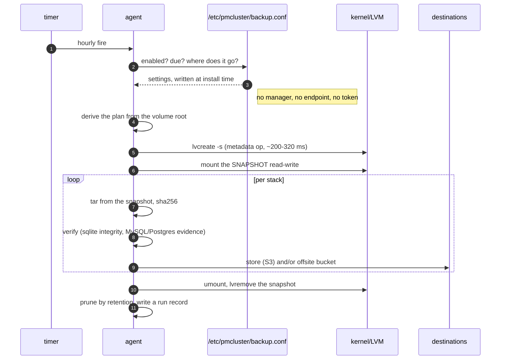

# The backup, end to end

What a run does, what it promises, how each promise is checked, and what it does
not do. Three diagrams rather than one wall of boxes; the prose under each one is
the part to argue with.

Colour key for the diagrams: **green** = in code, tested, running in production ·
**amber** = host/ops requirement, no code · **purple** = data · **red** = not
built.

A node needs `flock` (util-linux), `lvcreate` / `lvs` / `lvremove` (lvm2), `mount`,
`umount`, `tar`, `gzip`, `losetup`, `pvcreate`, `mke2fs`, `findmnt`, `blkid`.
**Not** `fsfreeze` — nothing is frozen (see §2). **Not** `sqlite3`, `psql` or
`pg_controldata`: SQLite verification links into the binary, and Postgres and
MySQL are recognised from their on-disk files rather than interrogated.

---

## 1. Once per node: making the volume snapshot-capable

```mermaid
sequenceDiagram
 autonumber
 participant OP as operator
 participant ST as storage
 participant K as kernel/LVM
 participant V as volume (thin LV)

 Note over OP,ST: once per node
 OP->>ST: storage provision (fresh) or storage migrate (data already there)
 ST->>K: file → PV → VG → pool → thin LV
 ST->>V: mount, copy, verify, switch
 ST->>ST: install units (pool, mount, backup timer)
 Note right of ST: refuses over live data unless drained;<br/>leaves two metadata copies free for a repair
```

The pool does not take the whole volume group: `2 × metadata` stays free, because
`lvconvert --repair` allocates a replacement metadata LV and a pool that fills its
group cannot be repaired at all. §3.1 of
[`storage-and-databases.md`](storage-and-databases.md) has the arithmetic.

## 2. Every hour: the timer asks, the node answers itself



**There is no freeze.** It used to be `fsfreeze -f`, which flushes every dirty
page and blocks writers until the disk acknowledges them. That flush is
unbounded and cannot be cancelled, and on a node whose pool is a file on the root
disk it competes with Docker, containerd, journald and sshd for the same device.
Measured in production: **19m29s of node-wide write stall**, kernel hung-task
reports, dockerd missing its swarm heartbeat, and every service on the node
rescheduled.

What the freeze bought was filesystem-metadata consistency, which a journaling
filesystem already guarantees: any instant is recoverable. A thin snapshot is a
metadata operation (~200-320 ms measured), and the copy is mounted **read-write**
so the journal replays on it — exactly what happens after a power cut, and the
same guarantee a cloud volume snapshot gives. Databases are unaffected: Postgres,
InnoDB and SQLite are crash-safe and replay their own redo on open. The one
invariant that matters is that the redo material lives in the *same* snapshot as
the data, which is why the volume layout check warns about redo co-location.

**There is no manager call.** The agent reads `/etc/pmcluster/backup.conf` (0600),
which `backup-agent install` writes from the cluster's settings. An earlier design
had the agent ask a manager over HTTP; that produced an unauthenticated port on
the private plane whose response carried the offsite bucket key.

## 3. Getting it back

```mermaid
sequenceDiagram
 autonumber
 participant OP as operator
 participant A as agent/CLI
 participant D as daemon
 participant V as volume (thin LV)

 OP->>A: backup browse <id>
 A-->>OP: the archive's contents, read without extracting
 OP->>A: backup-agent drill <artifact>
 A->>A: extract into scratch, open each database
 Note right of A: this is what proves restorability
 OP->>D: backup restore <id> [--from-s3] [--volume v]
 D->>V: extract one artifact, then prune the scope
 Note over OP,V: the snapshot is long gone;<br/>the ARTIFACT is the restore object
```

Restore is local-first: an artifact still on the node's archive directory is read
from disk; `--from-s3` forces the fetch. The fetch validates what it downloaded
before parsing it (gzip magic, ustar magic at offset 257, zero length, an
announced Content-Length that did not arrive), so an HTML error page or a
truncated body cannot reach the extractor.

---

## What the pictures imply

- **Nothing in the hourly path needs the leader.** The decision, the snapshot, the
  artifact and the record are node-local. A leader that dies mid-run costs the
  cluster the console view, not the backup.
- **Shipping is not on the consistency path.** Both upload legs run after the
  artifact exists; a store or bucket outage fails that artifact's shipping verdict,
  never its snapshot.
- **Restore reads one artifact, not the snapshot.** The snapshot is removed at the
  end of every run; if a run dies mid-flight, the next run's snapshot name is
  time-based, so a leftover LV is visible in `lvs` rather than silently reused.
- **A stack with no files is not an artifact.** The agent counts regular files
  before writing anything: an empty stack directory (what a moved volume leaves
  behind) produces no artifact, no upload and no row, and the run says so per
  stack. An archive of directory entries restores zero files, which is
  indistinguishable from a broken backup.
- **One retention implementation.** The dense/sparse plan is computed once
  (`planPrune`) and applied to the node's archive directory, the in-cluster store
  and the offsite bucket. Default: every hourly artifact for 48 hours, then one
  per day to day 3; `backup_retention_days` moves the sparse end, and nothing else.
- **The store and the bucket are the same kind of thing** — an S3 endpoint, a
  bucket and a credential. Two mechanisms (WebDAV for one, S3 for the other) meant
  two upload paths, two retention implementations and two sets of timeouts.

## What "verified" means, precisely

| artifact holds | verdict | how |
|---|---|---|
| one or more SQLite databases | `verified sqlite` | each database is opened in-process and gets `pragma integrity_check` |
| MySQL / MariaDB datadir | `mysql` + evidence | InnoDB system tablespace, data dictionary and redo log present; **not** opened — no client or server on the host |
| Postgres datadir | `postgres` + evidence | control file and WAL present; **not** validated — start a cluster to confirm |
| no database | `archive readable` | the tar walks end to end |

Every artifact also gets a SHA256 recorded beside it. What was verified for run
`3470` on 2026-11-05: `pragma integrity_check` = `ok`, and rows present
(customers 1, contracts 1, payments 2, users 1, employees 3). What was verified
for `3464`: restored from S3, a throwaway `postgres:14` ran recovery on the copy
and the row counts matched the live database exactly (activities 8,
activity_change_requests 4, attachments 6, campaigns 2, contents 5,
donation_boxes 3).

## Failure modes seen in production, and what the platform does

| Failure | Symptom | Handling |
|---|---|---|
| `fsfreeze` flush outliving the run | node-wide write stall, dockerd heartbeat lost | removed; snapshot only (§2) |
| LVM commands deadlocking under concurrent `vgs`/`lvextend` | two storage ops stuck 12 min | every LVM call serialised through `internal/lvmlock` |
| Snapshot creation interrupted mid-flight | orphaned thin device id; **every** later `lvcreate -s` fails while the volume looks healthy | `storage status --verify` (probe) detects it; `storage repair` rebuilds the metadata |
| Pool sized to fill its group | `insufficient free space (0 extents)` on repair | provisioning reserves `2 × metadata`; `storage grow` keeps it |
| Disk-backed `/tmp` assumption | a 900 MB artifact could not be staged on a 1839 MB node | fetched archives are staged in the archive dir, not `tmpfs` |
| Artifact that is not an archive | 200 + HTML error page | classified before parsing; the error names bucket, key and endpoint |
| Empty snapshot | "extracted 0 files", indistinguishable from a broken backup | named as an EMPTY volume; no artifact is written for an empty stack |
| Retention set but ignored | nodes pruned at the flag default (15 days) whatever the setting said | one resolver: policy file → store → default (48 h + 3 days) |

## Not built, and known

| Item | State |
|---|---|
| Postgres PITR (WAL streaming) | designed, deliberately not written — [`storage-and-databases.md`](storage-and-databases.md) |
| Restore stopping the stack first | restore writes into a live volume root; the operator stops the stack |
| MySQL/MariaDB verification | evidence only, no open-and-check |
| Restore drill on a schedule | `backup-agent drill` exists, nothing runs it automatically |

## For review

1. **Is a metadata-only snapshot an acceptable consistency story for you?** It is
   the same guarantee as a cloud volume snapshot, and it removed a 19-minute
   production stall. The alternative — freezing — protects nothing a journaling
   filesystem does not already protect.
2. **Should a run that ships nowhere be a failure?** Today a node with no store and
   no bucket still archives locally and records success. That is honest on a
   single-box install and arguably wrong on a fleet.
3. **Should `verify` open MySQL/Postgres too?** It would mean shipping a client
   into the host or starting a server per artifact. Right now the verdict says what
   it checked, which is the honest middle.
4. **Retention by count or by age?** Age only, per stack, with a floor of the
   newest two artifacts. A stack backed up twice a day and one backed up hourly
   keep very different numbers of copies for the same "3 days".
5. **Should restore drain the stack automatically?** It writes into a live volume
   root today; the scope pruning means a running app can see its files disappear
   mid-restore.
