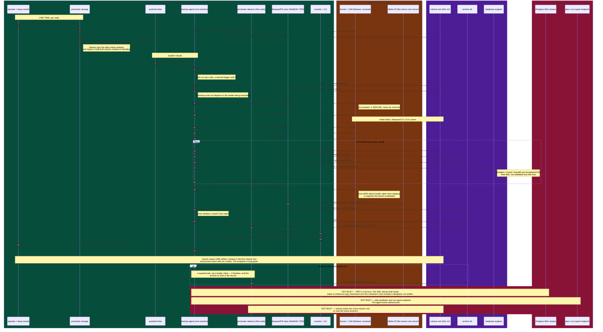

# One backup run, end to end

The whole pipeline in one picture: what is in code and running, what is a host
requirement, and what is deliberately not built. Read it top to bottom — the
first block happens once per node, the middle every hour, the last only when you
need the data back.

Colour key: **green** = in code, tested, running in production · **amber** = host
or ops requirement with no code · **purple** = data · **red** = not built.

Packages a node needs: `fsfreeze` and `flock` (util-linux), `lvcreate` / `lvs` /
`lvremove` (lvm2), `mount`, `umount`, `tar`, `gzip`, `losetup`, `pvcreate`,
`blkid`. `sqlite3`, `psql` and `pg_controldata` are **not** installed and not
needed: SQLite verification links into the binary, and Postgres and MySQL are
recognised from their on-disk files rather than interrogated.

## What the picture implies

- **The freeze is the only write stall, and it is node-wide.** Everything after
  `fsfreeze -u` reads a snapshot, so a slow tar cannot slow your database.
- **Shipping is not on the critical path of consistency.** The store leg runs
  after the thaw; a store outage fails the run's shipping verdict, not its
  snapshot.
- **Nothing in the hourly path needs the leader.** Plan, run, artifact and record
  are all node-local, which is why a leader outage costs you nothing but the
  console view until it returns.
- **The red block is a plan, not an oversight.** See
  [`storage-and-databases.md`](storage-and-databases.md#future-plan-postgres-point-in-time-recovery).
