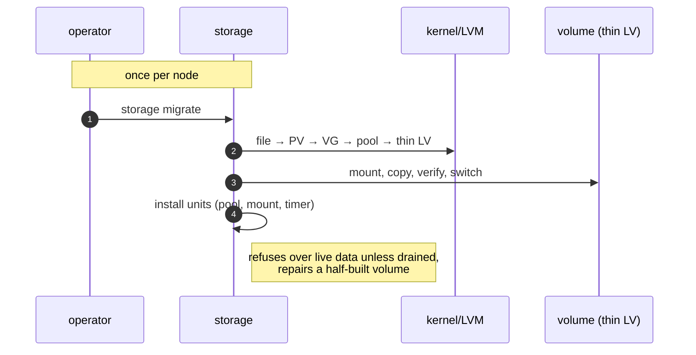
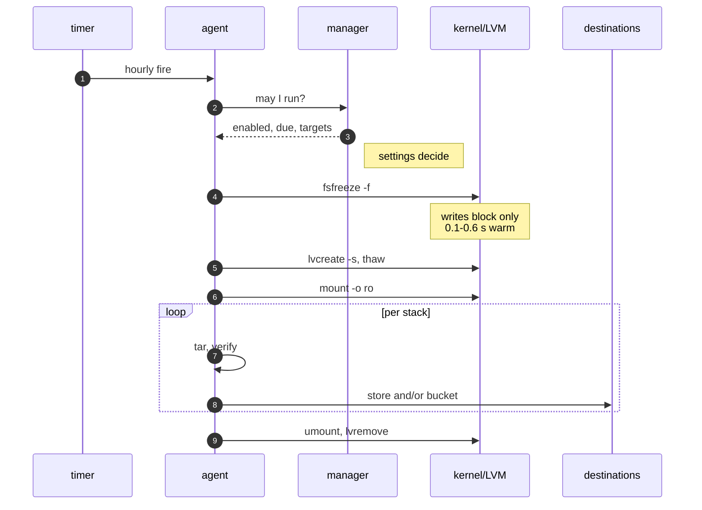
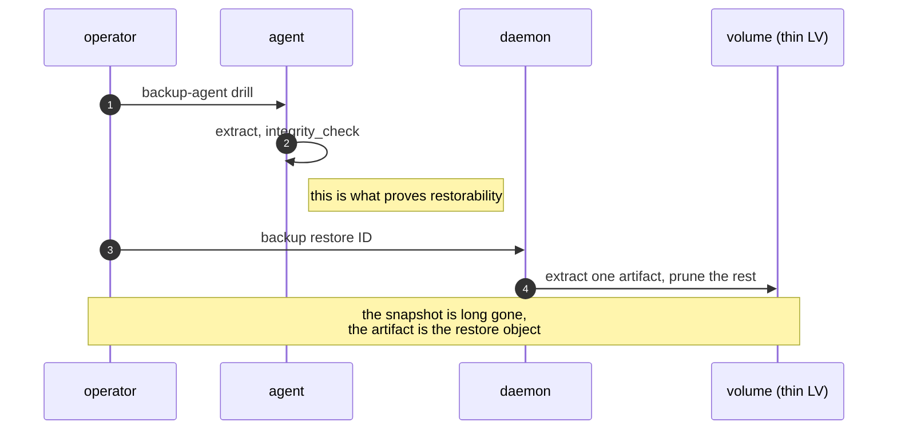

# One backup run, end to end

Three pictures, one per phase, rather than one wall-sized diagram: the whole
pipeline drawn at once is four and a half thousand pixels wide, which GitHub
shrinks until the labels cannot be read. Colour key: **green** = in code,
tested, running in production · **amber** = host or ops requirement with no code
· **purple** = data · **red** = not built.

Packages a node needs: `fsfreeze` and `flock` (util-linux), `lvcreate` / `lvs` /
`lvremove` (lvm2), `mount`, `umount`, `tar`, `gzip`, `losetup`, `pvcreate`,
`blkid`. `sqlite3`, `psql` and `pg_controldata` are **not** installed and not
needed: SQLite verification links into the binary, and Postgres and MySQL are
recognised from their on-disk files rather than interrogated.

## 1. Once per node: making the volume snapshot-capable

## 2. Every hour: a heartbeat asks, the control plane answers

## 3. Getting it back

## What the pictures imply

- **The freeze is the only write stall, and it is node-wide.** Everything after
  `fsfreeze -u` reads a snapshot, so a slow tar cannot slow your database.
- **Shipping is not on the critical path of consistency.** Both upload legs run
  after the thaw; a store or bucket outage fails that artifact's shipping
  verdict, never its snapshot.
- **Nothing in the hourly path needs the leader to survive.** The decision comes
  from a manager, but the run, the artifact and the record are node-local: a
  leader that dies mid-run costs the cluster its console view, not the backup.
- **Restore reads one artifact, not the snapshot.** The snapshot is deleted at
  the end of every run.
- **A stack with no files is not an artifact.** The agent counts regular files
  before it writes anything: an empty stack directory (what a moved volume
  leaves behind) produces no artifact, no upload and no row, and the run says
  so per stack. An archive of directory entries restores zero files, which is
  indistinguishable from a broken backup — the honest record is that this node
  had nothing to back up.

## Not built, and known

| Item | State |
|---|---|
| Postgres PITR (WAL stream) | designed, deliberately not written — see [`storage-and-databases.md`](storage-and-databases.md#future-plan-postgres-point-in-time-recovery) |
| Plan publisher / run-report endpoint | the agent works without both |
| Restore stopping the stack first | restore writes into a live volume root today |
