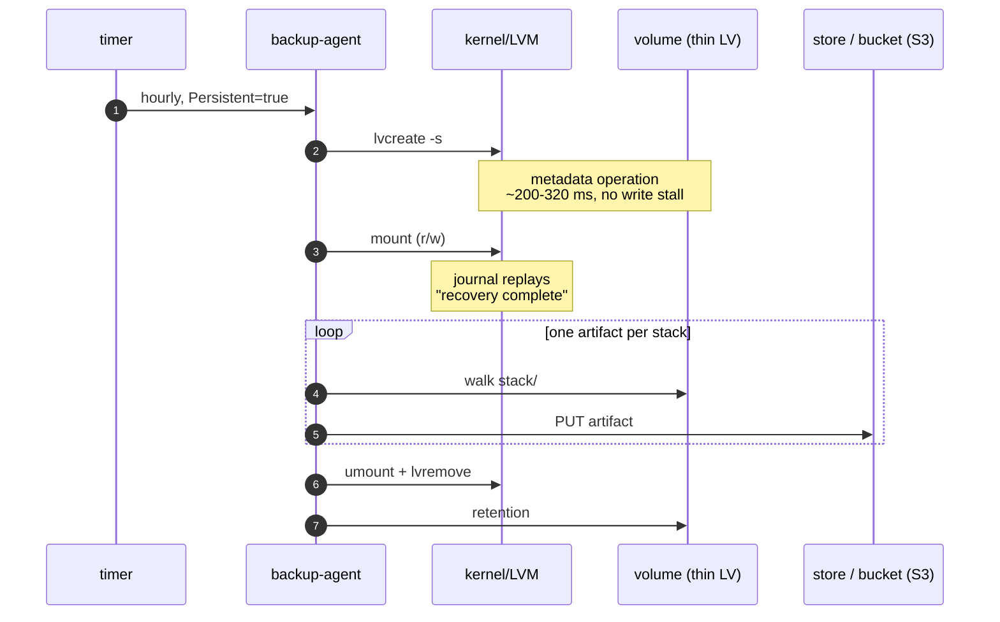
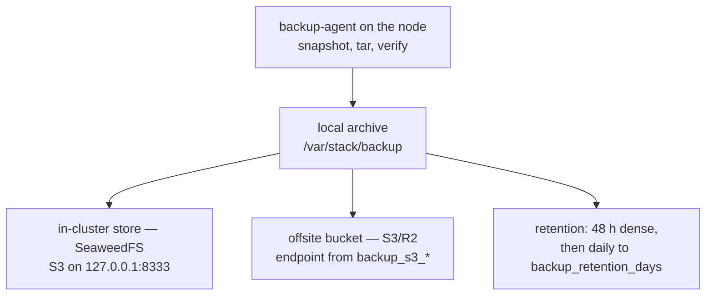
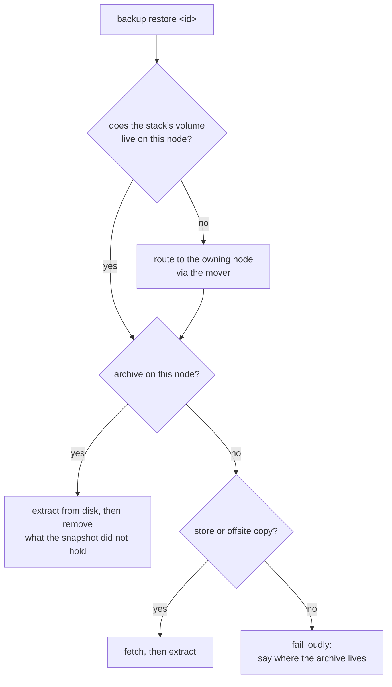

# Backups and restore

This is the one chapter for backups: how a volume is made snapshot-capable, what a
run does, where the bytes go, how long they are kept, and how to get them back.
Anything about *where data lives and how a stack gets its node* is in
[`storage-and-databases.md`](storage-and-databases.md); anything about *why* the
design looks like this is in the [whitepaper](whitepaper.md) §10.

Sections: [1 volume](#1-the-volume-that-makes-this-possible) ·
[2 schedule](#2-the-schedule-belongs-to-the-control-plane) ·
[3 the run](#3-one-run-end-to-end) · [4 artifact](#4-what-an-artifact-is) ·
[5 destinations](#5-three-destinations-one-mechanism) ·
[6 retention](#6-retention) · [7 control plane](#7-the-control-plane-agent) ·
[8 discovery](#8-how-pmcluster-knows-what-exists) · [9 restore](#9-restore) ·
[10 nothing restored](#10-when-a-restore-extracts-nothing) ·
[11 on demand](#11-on-demand-runs-and-drills) ·
[12 failures](#12-failure-modes-seen-in-production) ·
[13 not built](#13-not-built-and-known) · [14 review](#14-for-review)

---

## 1. The volume that makes this possible

A copy of a directory is a file-by-file walk of a tree the applications are still
writing to. So the first thing that has to be true is that `<volume_root>` is a
mount of its own snapshot-capable filesystem.

```
app-data.img                  sparse file, 75% of the disk (8 GiB..128 GiB)
 └─ /dev/loopN                loop device, found by file not by number
    └─ vg-pmcluster           # volume group (LVM)
       ├─ pool                 thin pool: file minus 1 GiB, minus the repair reserve
       │   ├─ [pool_tmeta]     thin metadata, pinned to ≈ pool/1000 at creation
       │   └─ [pool_tdata]
       └─ data                 thin volume: 80% of the pool
          └─ /var/stack/data   ext4, noatime
```

```bash
pmcluster storage status                 # what this node has, and why not
sudo pmcluster storage status --verify   # prove it by taking a snapshot
sudo pmcluster storage provision         # empty node: build it
sudo pmcluster storage migrate           # existing node: build, copy, verify, switch
sudo pmcluster storage grow --size 64G
sudo pmcluster storage repair --unmount  # thin metadata drifted: rebuild it
```

The data volume is deliberately smaller than its pool: each run allocates pool
blocks for the snapshot's divergent writes, and a volume that already fills its
pool leaves the snapshot nowhere to go. The missing fifth is that room, and the
agent aborts a run at 80% pool usage rather than ship a snapshot the kernel may
invalidate mid-copy.

**The pool also leaves the volume group two metadata copies of free extents** —
`2 × pool/1000`, 88 MiB on a 42 GiB volume. That space is not for snapshots. It is
what makes the pool *repairable*: `lvconvert --repair` writes the repaired
metadata as a new logical volume and keeps the damaged one beside it, so a pool
that occupies its group to the last extent cannot be repaired at all — LVM answers
`insufficient free space (0 extents): 11 required` and the only exit is destroying
the volume. `storage grow` therefore extends by free-space *minus* this reserve
instead of `+100%FREE`, and the metadata size is passed to `lvcreate
--poolmetadatasize` rather than inferred, so the reserve is arithmetic and not a
guess about the local LVM build.

`setup` asks once and provisions before the cluster deploys; `join --storage-node`
provisions the node being added; `cluster up` refuses to deploy when a backing
file exists but nothing is mounted — that state is indistinguishable from a fresh
node by `ls`, and deploying onto it runs every stack on an empty directory.

### 1.1 When the metadata does drift

Thin metadata can disagree with itself without the volume looking any different.
The production case: a snapshot creation interrupted mid-flight leaves a thin
device id allocated with no logical volume behind it, and from then on every
`lvcreate -s` on that node fails with `already contain thin device with device_id
N` — the volume mounts, the group is present, and every hourly backup fails.

`storage status` reads the layout, so it cannot see this; `--verify` takes a
snapshot and removes it, which is the operation the agent performs. `storage
repair` rebuilds the metadata and then proves the fix the same way. It needs the
pool inactive (so the volume root is unmounted, which means stopping its writers)
and it refuses up front, with the shortfall named, when the group has no free
extents — rather than letting LVM create a metadata backup and then fail.

A pool that is already at zero free extents cannot be given headroom by shrinking
it: LVM refuses to reduce a thin pool's data volume (`Thin pool volumes
vg-pmcluster/pool_tdata cannot be reduced in size yet`), whatever the data volume
is using. The room has to be added instead, which is one gigabyte of disk and
leaves the reserve free afterwards:

```bash
sudo pmcluster storage grow --size <current image + 1G>   # extends by free minus the reserve
sudo pmcluster storage repair --unmount
```

`--rebuild --allow-data-loss` destroys and re-creates the volume when the metadata
is beyond repair. It reproduces the shape it found — same pool, same data size,
same pinned metadata size — so the next run sees the volume it left. The data on
it does not survive; that is the whole point of the flag.

---

## 2. The schedule belongs to the control plane

`pmcluster-backup.timer` fires every hour and means nothing on its own. Before
each run the agent reads its policy — `/etc/pmcluster/backup.conf`, mode 0600 —
and obeys it:

| setting | effect |
|---|---|
| `backup_enabled` | `false` ⇒ the agent exits without taking a snapshot |
| `backup_cron` | a run happens only when the current minute matches |
| `backup_store_on` | `off` ⇒ no in-cluster store is deployed or written |
| `backup_retention_days` | how far back the sparse tail is kept (§6) |
| `backup_s3_*` | a complete set ⇒ artifacts are also uploaded offsite |

The file is written by `pmcluster backup-agent install` from the cluster's
settings, and the same values are editable from the console and the CLI
(`pmcluster backup enable`, `backup disable`, `backup schedule "0 2 * * *"`).

**There is no endpoint and no cross-node call.** An earlier design had the agent
ask a manager over HTTP; that turned into an unauthenticated port on the private
plane, and — worse — the response carried the offsite bucket key, which any
container on the overlay could have read. The policy file removes the question
entirely: a node never asks another node for permission.

**Why a file and not a read of the node's own store?** Managers carry the full
settings in their control-plane database, and a promoted leader keeps them (the
survivor kit restores the newest `pmcluster_state_*` config on promotion, and a
standby's `data.db` holds the same rows). **Workers do not**: their copy is as old
as their last restore from the daily archive, so a worker reading its own store
silently falls back to hourly defaults. That is why the policy is a file the
platform writes rather than a setting the node looks up. When the file is absent
the agent falls back to the node's own copy of the store, then to the defaults — a
cluster that has not configured backups still gets backups.

**The timer is a heartbeat. Do not edit it.** Changing its calendar changes
nothing — the decision comes from the policy above. The run lock belongs to the
agent, not the unit, so a forced run and the hourly run can never overlap.

---

## 3. One run, end to end

The per-volume archiver this platform used to ship (offen/docker-volume-backup) is
gone. It tarred a live directory, so one growing SQLite file could abort a node's
whole hour, and that is not a bug to fix but a design to replace.

What runs instead is a privileged one-shot on each node,
`pmcluster-backup.timer` → `pmcluster-backup.service` → `pmcluster backup-agent
run`. It runs on the host rather than in a Swarm task because a task can be
rescheduled mid-run, cannot hold a lock across the run, and has no ordering
against the filesystem it is archiving.



There is no freeze, and that is deliberate.

An earlier version ran `fsfreeze -f` around the snapshot. It was removed after it
took a production node down: the freeze flushes every dirty page and blocks
writers until the disk acknowledges them, which is unbounded and cannot be
cancelled. On a node whose pool is a loop file on the root disk that flush
competes with Docker, containerd, journald and sshd for one device. Measured:
**19m29s** of write stall, kernel hung-task reports, dockerd missing its swarm
heartbeat, and every service rescheduled. The same code on an idle node froze for
**216 ms** — the cost is a property of write rate, not a constant.

What the freeze bought was filesystem-metadata consistency, and the filesystem
already guarantees that itself: a journaling filesystem keeps "the on-disk state
is always recoverable" true at every instant, so a thin snapshot — a metadata
operation, **~200-320 ms measured** — captures a recoverable state. The copy is
mounted **read-write** so its journal replays, exactly as it would after a power
cut. That is crash consistency, and it is the same guarantee cloud volume
snapshots give.

Databases do not need anything more: PostgreSQL, InnoDB and SQLite are crash-safe
by design and replay their own redo on open. The one invariant is that the redo
material must sit in the **same snapshot** as the data — `pg_wal`, InnoDB redo and
the SQLite `-wal` file must live in the stack's own volume, never on a separate
volume or outside the pool. A database split across two snapshotted volumes is the
single silent-unrestorable case, and it is a volume-layout rule rather than an
engine plugin.

The honest trade: this is crash consistency, not application consistency. A volume
mounted `data=writeback`, or a store that writes multi-file state without fsync
(Redis with `appendfsync no`), can come back needing a documented repair step.
Stacks that need sub-hour RPO get WAL shipping as a per-stack option; the
mechanism above stays engine-agnostic.

**A run refuses rather than degrades.** If the volume root is not a mount of the
expected logical volume — a fresh node, or one whose boot ordering failed — the
agent exits non-zero and writes no artifact. It never falls back to tarring the
live tree; that fallback is the failure this design exists to remove.

---

## 4. What an artifact is

One `tar.gz` per stack, per run: `backup-<nodeID>-<timestamp>-stack-<stack>.tar.gz`,
members under `backup/data/<stack>/…`. An ordinary tarball — `tar -xzf` it without
pmcluster. Not inventing a format is the point.

Beside it, a `manifest.json` carries the sha256, size, which node took it, which
snapshot it came from, and the verification verdict. **The sidecar is uploaded
next to the archive** — to the store and to the offsite bucket, before the
archive itself, so a failed second upload leaves an orphan manifest (which
pruning removes) rather than an artifact whose provenance is gone. Without the
sidecar an offsite tar.gz is a file nobody can prove is the one that was taken;
with it, `backup restore` refuses an artifact whose sha256 does not match, and
says which hash it expected.

Verification opens the archive and checks what can be checked from the host:

| engine | what is verified |
|---|---|
| SQLite | `PRAGMA integrity_check` on every database in the artifact |
| PostgreSQL | control file and WAL present — recognised, not validated |
| MySQL / MariaDB | InnoDB system tablespace, data dictionary, redo log, Aria control file — recognised, not validated |
| none | `archive readable` — the tar walks end to end |

That distinction is deliberate: a green tick that claimed to validate a Postgres
cluster from the host would be a lie the console then repeats.

---

## 5. Three destinations, one mechanism



**The local copy is written first.** An artifact on disk says nothing about the
shipped legs, which is why the run reports per stack and a shipping failure marks
that stack failed while leaving the artifact intact and restorable.

**All three destinations are the same kind of thing**: a filesystem path, or an
endpoint + bucket + region + credential. The agent uploads to the store over the
node's own loopback (a host process cannot resolve the overlay name
`backup_seaweedfs`) and to the offsite bucket directly. WebDAV used to be the
store's protocol — it existed because "the S3 API does not auto-create a bucket",
and SeaweedFS does — so one of the two legs was a second protocol with its own
timeout, retention half and failure mode.

Credentials live in `/etc/pmcluster/backup.conf` (mode 0600), never in the
world-readable unit and never on a command line: argv is world-readable in
`/proc` for the life of the process.

**The store sits on a non-storage node**, by explicit placement, so the durable
copy lives in a different failure domain from the data. That placement is derived,
not configured: adding a storage label to the last non-storage worker moves the
store onto the platform node, and because the store's volume is node-local its
history does not follow. Worth an explicit setting.

**Offsite is the agent's second leg, optional and independent.** The agent uploads
the artifact it just verified straight to an S3-compatible bucket (IONOS/R2/AWS),
signed with SigV4, with the same bounds as any other network call. The in-cluster
store and the offsite bucket are separately configurable: either, both, or
neither.

**Every stack records where its artifact went.** The run's per-stack record
carries `where`: `node:<artifact>` always, plus `store:` and `s3:` when those legs
ran. Once a backup can live in three places, "succeeded" is not an answer to
"where is the copy of this stack".

---

## 6. Retention

Each run prunes its own archive directory: everything for 48 hours, then one
artifact per calendar day until `backup_retention_days` (3 by default), judged per
stack. The newest copies of a stack are never deleted, and whole-node archives
from the previous agent are left alone unless asked (`--legacy`) — on a fleet
mid-cutover those are the only backups that exist.

The same plan is applied to the store and the offsite bucket (one implementation,
`planPrune`), and the number comes from one place: the node's policy file first,
then its copy of the store, then the default. It used to be decoration — every
node pruned at the `--keep-days` flag default while the setting said otherwise —
so `pmcluster backup prune` and the hourly agent now share the resolver too.

```bash
pmcluster backup prune --dry-run
pmcluster backup prune --keep-hours 72 --keep-days 30
```

Retention is by age, not by count: an hourly stack and a twice-daily stack keep
very different numbers of copies for the same "3 days". The floor is the newest two
artifacts of every stack, whatever the clocks say.

**Nothing is deleted on a read path.** Listing backups — the console's page, the
API, `backup list` — used to run a flat "older than N days" deletion as a side
effect, which ignored both of the protections above: a stack that had been quiet
for four days lost its only copies by someone *opening a page*, and whole-node
archives the plan spares were removed outright. The audit rows of artifacts on
other nodes went with them, because on the leader those paths do not resolve and
the age test was the only one applied. Deletion now happens only where the plan is
applied: the hourly agent, or `backup prune` (which removes the audit rows of the
artifacts it actually deleted, matched by name).

---

## 7. The control-plane agent

Separate, and unchanged: `backup_control-plane-backup` still runs only on the
manager holding `~/.pmcluster`, archiving `data.db`, `.encryption_key`,
`config.yaml` and the rendered config tree. Daily at `0 3 * * *`, 30-day
retention, `pmcluster-ctlplane-` prefix — so a lost manager disk is not a full
re-bootstrap.

`RestoreControlPlane(archive, dataDir)` + `NewestControlPlaneArchive(dir)` are used
by `pmcluster serve` on startup: the newest `pmcluster-ctlplane-*.tar.gz` is
restored into `~/.pmcluster` **only when the local database is missing or older
than the archive**. A current database is never clobbered, which is what makes the
standby-promoted-to-leader path safe.

---

## 8. How pmcluster knows what exists

The agent writes artifacts; the daemon **indexes** them. Discovery reads the local
archive dir and the store (S3 `ListObjectsV2`, `backup-` prefix, control-plane
archives deliberately excluded), and gives each unique tarball exactly one row
(migration `0018_backup_filename.sql`, unique partial index on `filename`), so
`pmcluster backup list` shows scheduled and on-demand runs with real paths.
Discovery never deletes anything.

**A discovered run is not automatically a success.** Finding an archive proves the
run produced *something*, not that every destination received it. When an offsite
target is configured, discovery checks it for each newly discovered artifact and
records:

| status | meaning |
|---|---|
| `succeeded` | on disk, and the configured offsite bucket holds its copy |
| `offsite-missing` | on disk, offsite copy absent — or the bucket could not be read at all. The row's note says which |
| `succeeded` | nothing configured offsite, so there is nothing to verify |

`offsite-missing` is deliberately not `failed`: the artifact is intact and
restorable. It exists so an offsite outage cannot read as a clean backup history.

**An empty volume is not an artifact.** The agent counts regular files before it
commits to an artifact. A stack whose directory exists on a node but holds no
files (the leftover of a stack whose volumes moved) produces **no artifact, no
upload and no row**; the run stays green and names the stack: `○ <stack> nothing to
archive — no files under /var/stack/data/<stack> — the volume is empty on this
node`, plus a run-level warning. Without this the node kept writing a "succeeded"
archive of directory entries that restores zero files — seven of the twenty most
recent artifacts in the reference cluster were exactly that. Artifacts recorded
before this rule carry the note `empty: 0 files — the volume was empty on this node
when the snapshot was taken`, read from their sidecar manifest.

---

## 8.1 What the plan knows, and what it refuses to archive

The hourly plan lists the stacks that **exist**. `pmcluster serve` republishes it
every 15 minutes (each node from its own view of the swarm), so a directory whose
stack was removed becomes an *orphan*: named in the plan's `orphans` list, reported
by the run, and **not archived**. On one production node those leftovers were 87 MB
of an 491 MB hourly payload — volumes of stacks that no longer exist, copied hourly
forever.

Two guards keep "skip" from meaning "silently stopped backing up a live stack":

- a directory whose contents changed **after** the plan was generated is archived
  anyway (a stack deployed since then is writing there);
- every skipped directory is named in the run output, and `backup-agent run
  --include-orphans` keeps them for an operator who wants the belt and braces.

A node that cannot list services (a worker, which by role holds no stack data)
writes no plan at all and keeps the older behaviour: derive from the volume root
and archive everything.

---

## 9. Restore

```bash
pmcluster backup list                 # every run, newest first, with status
pmcluster backup browse <id>          # what is inside those archives
pmcluster backup restore <id>         # put it back
```

`pmcluster backup restore <id>` extracts a successful run under the volume root
(`--dest-root` overrides it), with `--volume <name>` narrowing to one volume and
`--from-s3` forcing a fetch from the offsite `backup_s3_*` bucket. REST:
`POST /api/backups/{id}/restore` `{dest_root}`; console `/web/backups/<id>` → Browse
→ Restore.

Restore is **local-first**, and fails loudly rather than silently restoring
nothing. A run recorded `offsite-missing` is restorable: only its offsite *copy* is
missing, while the archive on disk is the same snapshot. Refusing those would block
a restore during the one incident — an offsite outage — where an operator is most
likely to need one.



Details that prevent the classic accidents:

- **`--volume` is anchored to the stack.** On a stack-scoped run, `--volume db_data`
  can only ever match *that stack's* volume, so a bare name cannot pull another
  app's identically-named volume. On a whole-disk run a bare name matches every
  app, so scope it as `<app>/<volume>`.
- **A restore replaces, it does not merge.** Once the archives are extracted,
  entries under the restored scope that the snapshot did not hold are removed
  (`pruneToSnapshot`), so the volume ends up as the snapshot captured it. For a
  database that is the difference between a consistent rollback and a directory
  that is a union of two moments: a lock file or a log segment written *after* the
  snapshot describes a different point in time than the data pages beside it. The
  scope comes from the snapshot, never from the destination — an app deployed
  after the backup is not in the archive and is therefore untouched. Ordering is
  deliberate: the snapshot is read before anything is written and everything is
  extracted before anything is removed, so a restore that dies on a truncated
  archive leaves the volume as it was instead of half-empty. *(Merge-vs-replace is
  still an open decision — §14.)*
- **A restored volume is the volume, not a pile of files with the right names.**
  File modes come from the archive (a `0600` key stays `0600`, a script keeps
  `+x`), and symlinks and hard links are recreated rather than skipped. They used
  to be: everything was written `0644` and any entry that was not a plain file or
  directory was dropped, so a tree containing `current -> releases/v3` restored
  looking complete and silently missing files. Links are checked against the
  restore root before they are created, exactly like ordinary entries.
- **The stack is paused first.** A restore writes into the volume and then
  removes what the snapshot did not hold (`pruneToSnapshot`), so a running
  database keeps writing into files that are being unlinked under it — and what
  is left when it is finally started is a directory built out of two moments.
  `backup restore` therefore scales the stack's replicated services to zero,
  waits for the tasks to stop, writes, and scales them back (per service, in a
  `defer`, so a failed restore does not leave the app down). Two exceptions:
  a restore into a scratch directory (`--dest-root /tmp/…`) is for looking
  inside an artifact and never pauses anything, and `--no-drain` exists for the
  case where the stack is already dead. `global` services have no replica count
  to set, so they are named in a warning and left running — a lie about a
  drained stack is worse than a warning.
- **The restore runs where the volume is.** A stack's volume lives on its pinned
  storage node, so when the CLI runs elsewhere the restore is routed there through
  the same store-transit mover used by `stack move`. When routing is impossible it
  says "this stack's volume lives on `<node>` — run the restore there" instead of
  unpacking data onto the wrong host.
- **Path-escaped and control-plane archives are refused.** Extraction lands under
  `<dest_root>/<stack>` for stack-scoped runs, or `<dest_root>/<app>/<vol>/…` for
  whole-disk runs (the legacy archives bake in a `/backup/data/` prefix, which the
  restore strips — `archiveRelPath`). Nothing is ever written outside the volume
  root, and a `pmcluster-ctlplane-*` archive is refused into it: it holds
  `~/.pmcluster` state, not app data.
- **The archive dir is one answer for both sides.** `/var/stack/backup` by default,
  resolved through `cluster.BackupRootDir()` so the CLI reads the directory the
  agent wrote to (both honour `PMCLUSTER_BACKUP_DIR`) — not the old
  `/var/backups/docker-volumes`. A row may record the agent's *container* path
  (`/archive/<name>`), which browse and restore map onto the archive dir before
  declaring an archive missing.
- **A purge does not destroy your way back.** `cluster down --purge` first writes a
  restorable `purge-backup-<ts>.tar.gz` into the data dir and *keeps* it, and
  `pmcluster cluster reset --restore <archive>` extracts it before rebuilding the
  Swarm side. Plain `cluster reset` rebuilds networks, secrets, configs, platform
  stacks and storage labels from the local SQLite store — the DB is the source of
  truth and the Swarm is derived.
- **A restore writes in place.** Services still running against those files see the
  new contents on their next read or task start; for a zero-downtime data refresh,
  re-deploy the stack and restore onto a fresh task. Draining automatically is not
  built (§13).

---

## 10. When a restore extracts nothing

Three different conditions produced the same sentence, and only one of them is a
bug in the restore. They are now distinct, and `Restore` refuses all three with the
cause named:

| message | meaning | what to do |
|---|---|---|
| `… contains only directories, so the snapshot captured an EMPTY volume` | the artifact is intact; the volume was empty when it was taken | the stack's data lives on another node — restore that node's artifact |
| `… holds N file(s), none of which matched the restore scope (volume "x")` | the artifact is intact and full; the filter excluded every entry | fix `--volume` (stack-scoped runs anchor it to the app) |
| `offsite artifact <key> …: not an archive` | the object exists but is not a tar.gz — an HTML error page, a JSON sidecar, an empty body | the key or the endpoint is wrong; nothing was written to disk |

Guards behind those messages: `fetchS3Object` rejects a 200 with an empty body and
a body shorter than the announced `Content-Length` (nothing is kept);
`restoreSource` classifies the fetched bytes (gzip magic, `ustar` at offset 257,
zero length) before the extractor ever sees them; `listArchive` errors on a
non-archive and on a zero-entry archive instead of returning an empty list. A
fetched archive is staged in `<archive dir>/.restore-tmp` — `/tmp` is a tmpfs on
the reference hosts, so staging there would cap a restore at the node's free RAM.

---

## 11. On-demand runs and drills

```bash
pmcluster backup create --stack my-app       # now, on this node (needs root)
pmcluster backup-agent run --force           # the agent's own entry point
pmcluster backup-agent drill <artifact>      # extract and open every database inside
```

`backup_before_deploy: true` in a manifest takes the same snapshot before a deploy.
The drill is the check that makes "backed up" mean something: it extracts the
artifact into a scratch directory and proves the databases inside it open and
answer an integrity check.

**It runs on its own.** `backup-agent install` now also writes
`pmcluster-backup-drill.timer` — weekly, Sunday 03:00, randomized over 30 minutes
so a fleet does not all extract at once — which runs `backup-agent drill
--newest 1`: the newest artifact in the archive dir, extracted into a scratch
directory and verified. The schedule is deliberately not hourly: a drill costs
the I/O of a restore and must not run beside the backup it is testing.

Three guards make an unattended drill safe:

- **space**: the drill needs the archive's size a second time plus 256 MiB of
  headroom, and refuses with the numbers (`not enough space under /tmp …`)
  instead of filling the volume a backup just freed;
- **time**: `TimeoutStartSec=1800` — a drill that hangs holds a database copy open;
- **an empty archive dir is not a failure**: a node with nothing to drill says so
  and exits 0.

The result is recorded in `<state-dir>/drill/status.json` (last drill plus a
12-entry history, mode 0600), so "have we actually restored anything this month?"
does not depend on someone's memory:

```bash
pmcluster backup-agent drill-status
pmcluster backup-agent drill --newest 1        # now
pmcluster backup-agent drill backup-<node>-<ts>-stack-<stack>.tar.gz
```

---

## 12. Failure modes seen in production

| failure | symptom | handling |
|---|---|---|
| `fsfreeze` flush outliving the run | node-wide write stall, dockerd heartbeat lost | removed; snapshot only (§3) |
| LVM commands deadlocking under concurrent `vgs`/`lvextend` | two storage ops stuck 12 min | every LVM call serialised through `internal/lvmlock` — the snapshot's `lvcreate` **and** every `lvs`/`lvremove` the agent runs: the inversion belongs to the command, so guarding one call left four able to reproduce it (`TestEveryLVMCommandRunsUnderTheLock`) |
| snapshot creation interrupted mid-flight | orphaned thin device id; **every** later `lvcreate -s` fails while the volume looks healthy | `storage status --verify` detects it, `storage repair` rebuilds the metadata (§1.1) |
| pool sized to fill its volume group | `insufficient free space (0 extents)` on repair | provisioning reserves `2 × metadata`; `storage grow` keeps it (§1) |
| RAM-backed `/tmp` | a 900 MB artifact could not be staged on a 1839 MB node | fetched archives are staged in the archive dir (§10) |
| artifact that is not an archive | 200 + HTML error page | classified before parsing; the error names bucket, key and endpoint (§10) |
| empty snapshot | "extracted 0 files", indistinguishable from a broken backup | named as an EMPTY volume; no artifact is written for an empty stack (§8, §10) |
| retention set but ignored | nodes pruned at the flag default (15 days) whatever the setting said | one resolver: policy file → store → default (§6) |
| archiver given two S3 backends | `cluster update` died rendering `backup-stack.yml` (duplicate keys) | one backend per process, offsite first |

---

## 13. Not built, and known

| item | state |
|---|---|
| Postgres PITR (WAL streaming) | designed, deliberately not written — per-stack option, see §3 |
| MySQL/MariaDB verification | evidence only, no open-and-check (§4); a boot check is the follow-on after drills |
| Postgres boot verification in a drill | evidence only today — replaying a datadir needs the engine version recorded next to the artifact |
| per-volume backup opt-out | not built on purpose: every large volume in the reference fleet is a live database, so the only use it would get is a mistake |
| merge-vs-replace on restore | replace is today's behaviour; the alternative is undecided |

---

## 14. For review

1. **Is a metadata-only snapshot an acceptable consistency story?** It is the cloud
   volume guarantee, and it removed a 19-minute production stall. The alternative —
   freezing — protects nothing a journaling filesystem does not already protect.
2. **Should a run that ships nowhere be a failure?** Today a node with no store and
   no bucket archives locally and records success.
3. **Should verification open MySQL/Postgres too?** That needs a client in the host
   or a server per artifact; today the verdict says exactly what it checked.
4. **Retention by age or by count?** Age only, per stack, floor of the newest two.
5. **Should restore drain the stack first?** It writes into a live volume root, and
   scope pruning means a running app can watch files disappear mid-restore.
6. **Should the offsite leg be mandatory when configured?** A shipping failure
   marks the stack failed but the local artifact stays successful for discovery.
