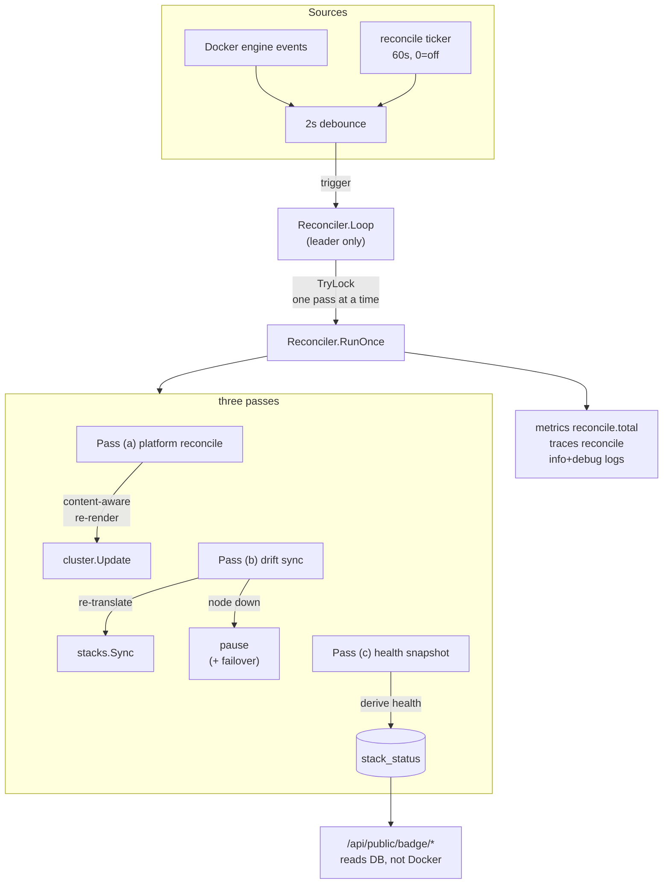

# Control loop — architecture

## How the loop works

Key properties:

- **Leader-only.** `WatchSwarmLeadership` channel starts/stops the loop. Workers
  and standby managers never run it — a worker daemon logs "standing by (no
  control loop)" once and stays idle instead of re-running the doomed
  manager-only reconcile.
- **Event + tick.** Docker events arm a 2s debounce; the interval tick is the
  safety net (a closed event stream disables that case and falls back to the
  ticker). One pass at a time (TryLock skips).
- **Three passes per run.** (a) platform configs re-rendered + hash-compared +
  drifted stacks redeployed (no TLS/credential churn; `cluster.Update` is also
  existence-aware — a stack missing from the swarm is redeployed even on a
  matching hash); (b) each app stack's latest source re-translated and synced
  when the rendered hash drifted; (c) per-stack + per-service health written to
  `stack_status`, stale rows pruned.
- **Two drift signals.** The *stored* rendered hash (what pmcluster last
  intended) is compared against a fresh render — and when they match, the *live*
  Swarm is still checked via the `io.pmcluster.rendered_hash` label every
  deployed service carries: a manual `docker service update`, a half-applied
  deploy or a wiped service re-applies even though the stored hash is unchanged.
  The revision's rendered hash is stamped **only after a successful apply**, so
  a failed deploy always looks drifted to the next pass and is retried.
- **Storage-node outage pause.** When a stack's pinned storage node is down
  (absent, not `ready`, or not `active`), pass (b) skips that stack — deploying
  onto a node that cannot serve the data would recreate it against empty binds.
  The pause clears automatically when the node returns or the stack is moved.
  With `storage_failover=true` (and offsite backups configured) the loop instead
  picks a healthy alternate storage node and moves the stack there (S3/store
  restore, 5-minute per-stack cooldown, detached from the pass) — see
  [storage-and-databases.md](storage-and-databases.md).
- **Reports, never acts on health.** No auto-restart/force-update; crash-loop
  retry is Swarm's restart-policy job. The only actions the loop takes are
  drift re-applies and the opt-in storage failover.
- **Throttled failure logging.** A permanently broken stack (a sync that fails
  every pass) is logged and recorded **once per distinct error string** (plus a
  once-per-hour WRN heartbeat) and its status is marked `error` with the parse
  error; the same throttle applies to the "storage node down" pause warning
  (once per state change + hourly heartbeat).
- **Badges read the DB snapshot**, not live Docker — no flicker, no per-request
  swarm queries. An unacknowledged storage-failover marker dominates the badge
  ("failover", amber) until an operator `stack ack`s it or moves it back.

### Parallel leader loop: control-plane Raft snapshot

Alongside the reconciler, the leader runs `controlplane.Kit.Loop` (5-minute tick,
plus an immediate snapshot on promotion). It re-publishes the failover-survivor
kit (data.db, config.yaml, config/ tree — and the encryption key in a separate
config) into `pmcluster_state_*` / `pmcluster_state_key_*` Docker configs, which
Swarm's Raft store replicates to every manager. The snapshot only fires when a
kit file changed since the newest config (deploys, settings, secret/webhook
edits all land within one interval), prunes to the newest two, and fails loudly
when a payload would exceed Docker's 500 KiB config ceiling. It is independent
of `reconcile_interval` — a cluster with the reconcile loop disabled still keeps
its control plane replicated. See `internal/controlplane`.

**Restore is startup-only.** A promoted daemon never restores under its own
live-opened SQLite connection (Restore truncates data.db — the daemon would
serve stale page-cache rows while fresh readers see the clobbered file: a
split-brain). Instead, `serve` restores from the newest `pmcluster_state_*`
config **before the store is opened**, only when the local DB is missing or
older than the snapshot (a current DB — e.g. on shared storage — is never
clobbered), and repairs a missing `.encryption_key` even when the DB is
current. On promotion the leader only *publishes* a fresh snapshot. A worker
node or a leaderless swarm (quorum lost) degrades gracefully: snapshot/restore
become no-ops that retry later instead of crash-looping the daemon.
