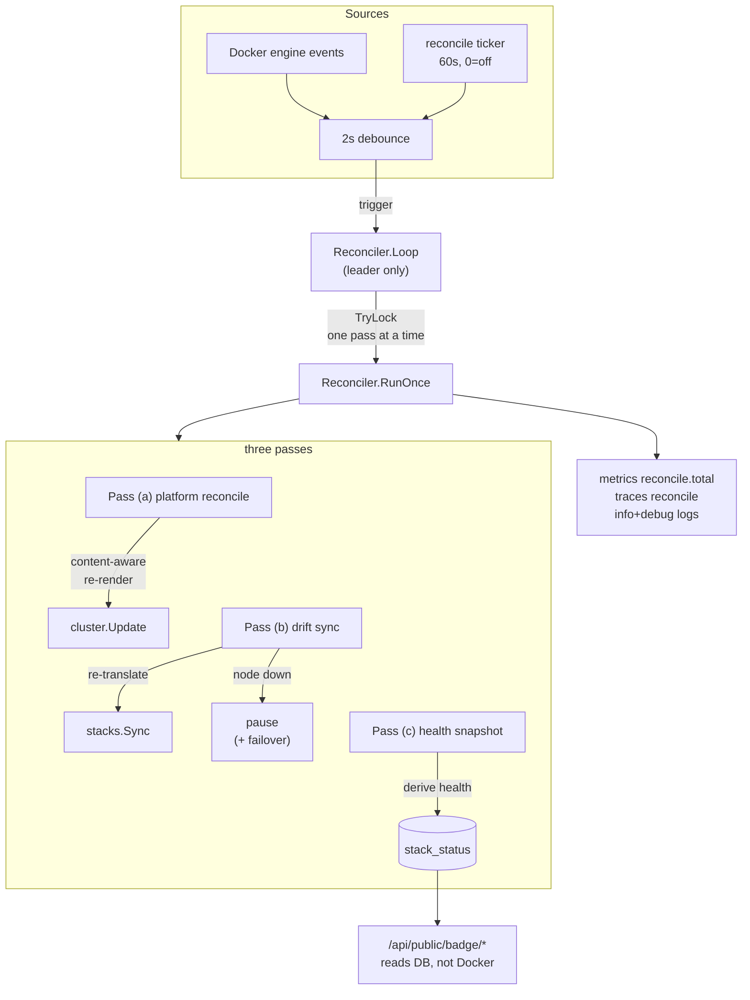

# Control loop — architecture

## How the loop works

Key properties:

- **Leader-only.** `WatchSwarmLeadership` channel starts/stops the loop. Workers
  and standby managers never run it — a worker daemon logs "standing by (no
  control loop)" once and stays idle instead of re-running the doomed
  manager-only reconcile.
- **Event + tick.** Docker events arm a 2s debounce; the interval tick is the
  safety net (a closed event stream disables that case and falls back to the
  ticker). One pass at a time (TryLock skips).
- **Three passes per run.** (a) platform configs re-rendered + hash-compared +
  drifted stacks redeployed (no TLS/credential churn; `cluster.Update` is also
  existence-aware — a stack missing from the swarm is redeployed even on a
  matching hash); (b) each app stack's latest source re-translated and synced
  when the rendered hash drifted; (c) per-stack + per-service health written to
  `stack_status`, stale rows pruned.
- **Two drift signals.** The *stored* rendered hash (what pmcluster last
  intended) is compared against a fresh render — and when they match, the *live*
  Swarm is still checked via the `io.pmcluster.rendered_hash` label every
  deployed service carries: a manual `docker service update`, a half-applied
  deploy or a wiped service re-applies even though the stored hash is unchanged.
  The revision's rendered hash is stamped **only after a successful apply**, so
  a failed deploy always looks drifted to the next pass and is retried.
- **Storage-node outage pause.** When a stack's pinned storage node is down
  (absent, not `ready`, or not `active`), pass (b) skips that stack — deploying
  onto a node that cannot serve the data would recreate it against empty binds.
  The pause clears automatically when the node returns or the stack is moved.
  With `storage_failover=true` (and offsite backups configured) the loop instead
  picks a healthy alternate storage node and moves the stack there (S3/store
  restore, 5-minute per-stack cooldown, detached from the pass) — see
  [storage-and-databases.md](storage-and-databases.md).
- **Reports, never acts on health.** No auto-restart/force-update; crash-loop
  retry is Swarm's restart-policy job. The only actions the loop takes are
  drift re-applies and the opt-in storage failover.
- **Throttled failure logging.** A permanently broken stack (a sync that fails
  every pass) is logged and recorded **once per distinct error string** (plus a
  once-per-hour WRN heartbeat) and its status is marked `error` with the parse
  error; the same throttle applies to the "storage node down" pause warning
  (once per state change + hourly heartbeat).
- **Badges read the DB snapshot**, not live Docker — no flicker, no per-request
  swarm queries. An unacknowledged storage-failover marker dominates the badge
  ("failover", amber) until an operator `stack ack`s it or moves it back.

### Parallel leader loop: control-plane Raft snapshot

Alongside the reconciler, the leader runs `controlplane.Kit.Loop` (5-minute tick,
plus an immediate snapshot on promotion). It re-publishes the failover-survivor
kit (config.yaml, config/ tree, the encryption key in a separate config, and an
EXPORT of `data.db`'s authoritative tables — see below) into
`pmcluster_state_*` / `pmcluster_state_key_*` Docker configs, which Swarm's Raft
store replicates to every manager. The snapshot only fires when a kit file
changed since the newest config (deploys, settings, secret/webhook edits all land
within one interval), logs the packed payload size at info on every publish,
prunes to the newest two, and fails loudly when a payload would exceed Docker's
500 KiB config ceiling. It is independent of `reconcile_interval` — a cluster
with the reconcile loop disabled still keeps its control plane replicated. See
`internal/controlplane`.

**What crosses the fleet, and what does not.** The kit's `data.db` is not the
leader's file: `controlplane` exports a fresh SQLite database that runs the
migrations and copies the authoritative tables — `users` (token hashes, roles,
scopes), `managed_credentials`, `stacks` (name, repo, deploy file,
current-revision pointer), `webhook_sources`, `registries`, `cluster_settings`,
`configs`, `secrets`, `site_certs`, `stack_failover` — plus a SHORT ROLLBACK
WINDOW on the two tables that grow without bound: `stack_revisions` arrives as
each stack's newest 5 revisions **and** the row `current_revision` points at
(which is not always one of them — a rollback leaves the pointer on an older
row), and `config_versions` as the newest 10 versions per config name, row ids
preserved so a rollback names the same row it would on the leader. Everything
else in those two tables, plus `backups`, `webhook_deliveries`, `stack_status`
and `node_stats`, stays behind. The caps live in one place
(`internal/controlplane/kitdb.go`) and are held by tests that pack 500
revisions and 200 versions per group and fail if either the caps or the size
budget drift.

This was forced by measurement: the leader's `data.db` reached 5.2 MB, 3.7 MB
of it revisions, 538 KB gzipped against the 512 KB ceiling, so every publish
was refused for days and the API keys, settings and secrets created in that
window existed only on one disk. A promoted leader now serves identical auth,
settings, secrets and stack LIST, can reconcile each stack against its current
rendered manifest without waiting for a re-deploy, and can roll a deploy back
within the window. A revision outside the window still reads as "no stored
revision on this node" (telemetry status `skipped`), handled once, at info,
instead of marking the stack errored; a config rollback further back than ten
versions is a leader-side operation, because only the leader holds the older
rows. `VACUUM INTO` was rejected for this: it copies everything, which is
precisely what does not fit.

**Adoption happens at startup AND on leadership gain.** Two call sites run the
same predicate, and they are the only two:

- **Startup, before `store.Open`.** `serve` restores from the newest
  `pmcluster_state_*` config only when the local DB is missing or older than the
  snapshot (a current DB — e.g. on shared storage — is never clobbered), and
  repairs a missing `.encryption_key` even when the DB is current. Nothing has
  the store open yet, so the kit is extracted in place.
- **On the follower→leader transition.** `Kit.AdoptOnLeadership`
  (`internal/controlplane/adopt.go`) runs once per transition, from the
  leadership goroutine *before* the reconcile loop reads settings/credentials and
  before the node answers control-plane reads. A manager that becomes leader
  while running is usually behind: the previous leader snapshotted API keys,
  credentials and settings it never adopted.

The mid-run case cannot extract in place — `data.db` is open, and writing it
under the live SQLite connection makes the daemon serve stale page-cache rows
while fresh readers see the new file (split-brain). Adoption therefore stages the
kit in a `.adopt-*` directory *inside* the data dir (same filesystem, so the final
move is an atomic `rename`), then closes the store (`store.Store.Swap`), renames
the kit into place with `data.db` **last**, writes `.state_revision`, and reopens
the same `*store.Store` every consumer already holds. The `.encryption_key` is
adopted with the DB, and the in-memory `credentials.Cipher` is reloaded in place
when the key changed — a cluster DB beside the node's old key leaves every
credential ciphertext undecryptable.

**The window in which the new leader is not yet serving.** Between the moment
Swarm elects the node and the moment adoption finishes, the daemon answers `503`
with `Retry-After: 1` and a JSON body that says it is adopting, for every route
except `/health` (`internal/cli/adoptgate.go`). The gate wraps the whole handler,
so it covers the REST API, the console's fragments and the webhook receiver
alike — anything that would read control-plane state. `/health` stays exempt
because liveness has to answer during an adoption: a leader that looks down for
the duration is a worse failure than the one being fixed.

A caller should retry once, not page. The window is one kit extract plus one
rename, plus any in-flight query the swap waits for; the gate's comment estimates
a few tens of milliseconds, and it has not been timed against a live failover, so
treat that as an order of magnitude rather than a number. A request already in
flight when the store closes may fail with `sql: database is closed`; retrying
succeeds. The alternative — answering from the revision being replaced — is the
silent rollback this machinery exists to prevent.

The journal names it: `control-plane data ADOPTED on leadership gain: store
closed, data.db + .encryption_key replaced, store reopened, revision advanced`,
with the config, the previous revision and whether the key changed. A node the
leadership finds already current says so and touches no file.

**A leadership move no longer serves stale state.** Before this, the failure was
silent: the new leader answered `200` from its own older revision, so an API key
created minutes earlier on the old leader returned `401` and read as a credential
bug on a node that had, in fact, already received the newer kit through Raft. Now
the same move is either invisible (the node was already current) or a short,
deliberate `503` — never an answer built from the revision being replaced.

Failures are contained, not fatal: an unreadable kit, a state config whose key
config is missing, or a payload that does not extract leaves the current database
in place, logs at ERROR with the reason, and keeps serving. A worker node or a
leaderless swarm (quorum lost) degrades gracefully: snapshot/adoption become
no-ops that retry on the next transition instead of crash-looping the daemon.
Adoption is never part of a tick: a node that stays leader does not close its
store, and a snapshot this node published itself is never adopted back.
