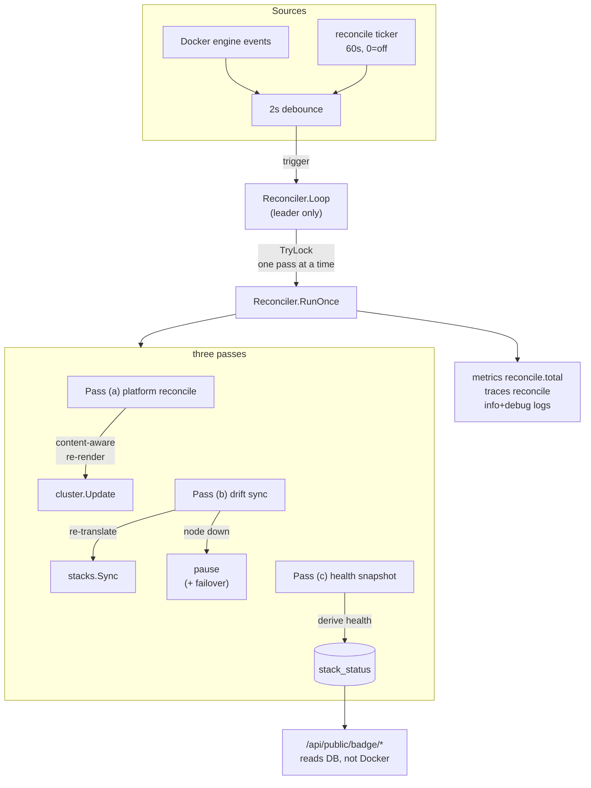

# Control loop — architecture

## How the loop works

Key properties:

- **Leader-only.** `WatchSwarmLeadership` channel starts/stops the loop. Workers
  and standby managers never run it — a worker daemon logs "standing by (no
  control loop)" once and stays idle instead of re-running the doomed
  manager-only reconcile.
- **Event + tick.** Docker events arm a 2s debounce; the interval tick is the
  safety net (a closed event stream disables that case and falls back to the
  ticker). One pass at a time (TryLock skips).
- **Three passes per run.** (a) platform configs re-rendered + hash-compared +
  drifted stacks redeployed (no TLS/credential churn; `cluster.Update` is also
  existence-aware — a stack missing from the swarm is redeployed even on a
  matching hash); (b) each app stack's latest source re-translated and synced
  when the rendered hash drifted; (c) per-stack + per-service health written to
  `stack_status`, stale rows pruned.
- **Two drift signals.** The *stored* rendered hash (what pmcluster last
  intended) is compared against a fresh render — and when they match, the *live*
  Swarm is still checked via the `io.pmcluster.rendered_hash` label every
  deployed service carries: a manual `docker service update`, a half-applied
  deploy or a wiped service re-applies even though the stored hash is unchanged.
  The revision's rendered hash is stamped **only after a successful apply**, so
  a failed deploy always looks drifted to the next pass and is retried.
- **Storage-node outage pause.** When a stack's pinned storage node is down
  (absent, not `ready`, or not `active`), pass (b) skips that stack — deploying
  onto a node that cannot serve the data would recreate it against empty binds.
  The pause clears automatically when the node returns or the stack is moved.
  With `storage_failover=true` (and offsite backups configured) the loop instead
  picks a healthy alternate storage node and moves the stack there (S3/store
  restore, 5-minute per-stack cooldown, detached from the pass) — see
  [storage-and-databases.md](storage-and-databases.md).
- **Reports, never acts on health.** No auto-restart/force-update; crash-loop
  retry is Swarm's restart-policy job. The only actions the loop takes are
  drift re-applies and the opt-in storage failover.
- **Throttled failure logging.** A permanently broken stack (a sync that fails
  every pass) is logged and recorded **once per distinct error string** (plus a
  once-per-hour WRN heartbeat) and its status is marked `error` with the parse
  error; the same throttle applies to the "storage node down" pause warning
  (once per state change + hourly heartbeat).
- **Badges read the DB snapshot**, not live Docker — no flicker, no per-request
  swarm queries. An unacknowledged storage-failover marker dominates the badge
  ("failover", amber) until an operator `stack ack`s it or moves it back.

### Cluster state: the mirror is the document, and adoption copies nothing

There is no control-plane Raft snapshot any more (ADR 0005). Cluster state reaches
every manager by the swarm-mTLS pull (`internal/clustersnapshot`, 60 s, with
`If-None-Match` so a quiet cluster costs a 304) and is mirrored into that manager's
own store. The mirror carries the WHOLE document — every table, minus the ones
whose rows describe the node they live on (`backups`, `node_stats`,
`github_runners`, `sync_state`, plus the two structural tables; see
`internal/store/mirror_tables.go` for both lists and a reason per exclusion). That
includes `stack_revisions` and `cluster_version`, so a promoted leader reads the
manifest behind its live stack pointer and continues the version counter.

**Adoption is a check, not a transfer.** `Kit.AdoptOnLeadership`
(`internal/controlplane/adopt.go`) runs once per follower→leader transition and
serves the store the node already has; nothing is staged, renamed or reopened, and
`store.Store.Swap` is gone with the path that used it. What it decides:

- a STALE mirror is served, and the version and age are logged ("adopting mirror
  version N, age Ts") — a promotion on a few-minutes-old snapshot beats no leader,
  and the journal carries the cost;
- a node that has never applied a snapshot AND holds no cluster state refuses,
  loudly, and starts no control loop: that is nothing to serve, not something old;
- a node that has never mirrored but holds state is the cluster's source (the first
  leader after `cluster up`);
- the encryption key is compared with its own config and a mismatch is a warning —
  the key route is the next decision.

Startup says the same thing without copying: `noderuntime.ConfirmMirrorAtStartup`
reports the leader, version and age it holds, or that it is waiting for the first
snapshot. A manager with no data yet starts, serves `/health` and says why.

**No Docker config is written at all.** The data kit `pmcluster_state_<ts>` went with
the mirror, the control-plane backup archive (`pmcluster-ctlplane-*.tar.gz`) went with
its service and its restore path — backups are service volumes only — and the key
config `pmcluster_state_key_<ts>` went last (ADR 0006). The cipher key is a file,
`<data dir>/.encryption_key`, minted once at `cluster init` and never rotated; it
reaches the other managers through the join route, or by an operator copying it. A key
that does not change needs somewhere to live, not a delivery channel.
