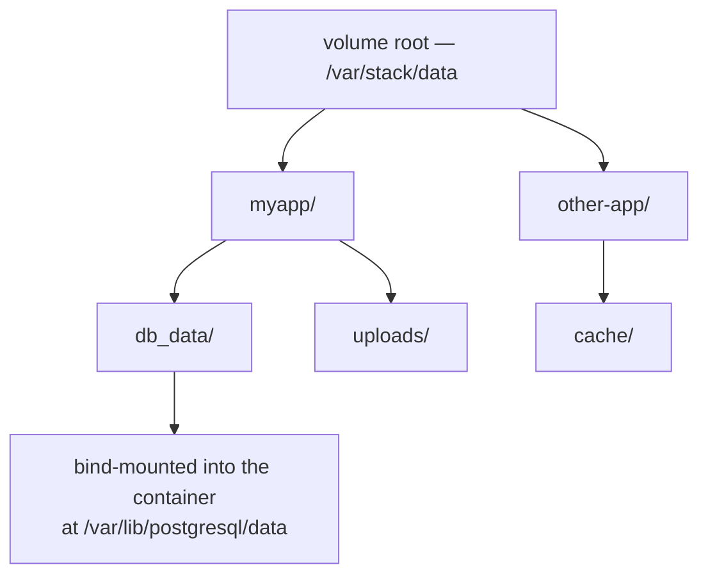
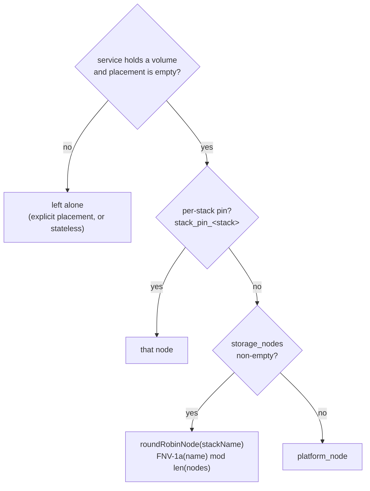
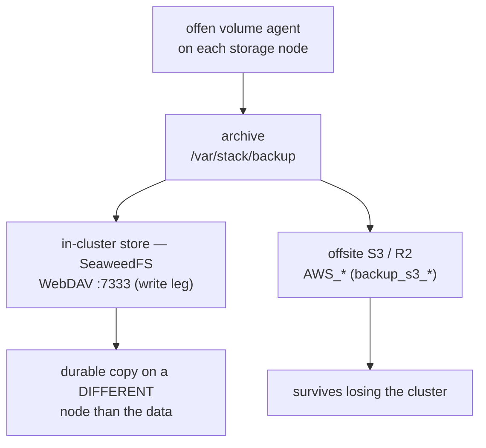
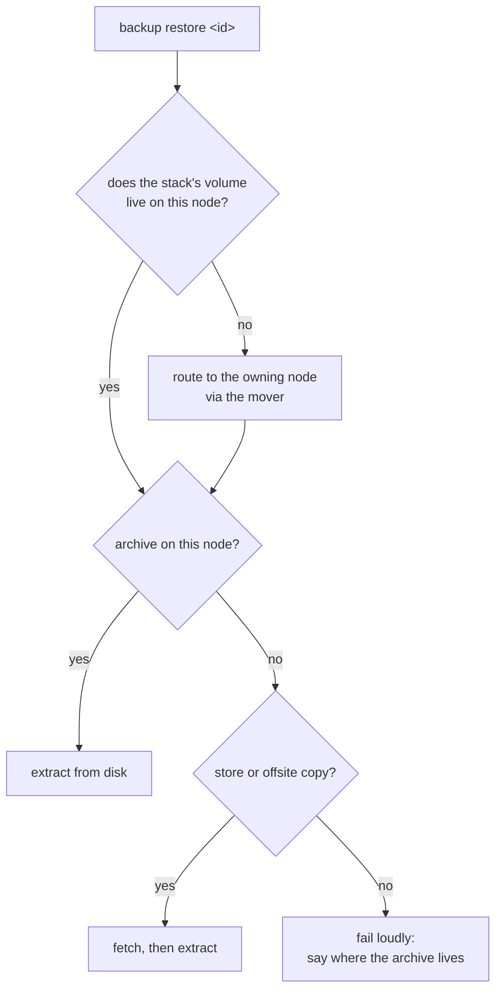
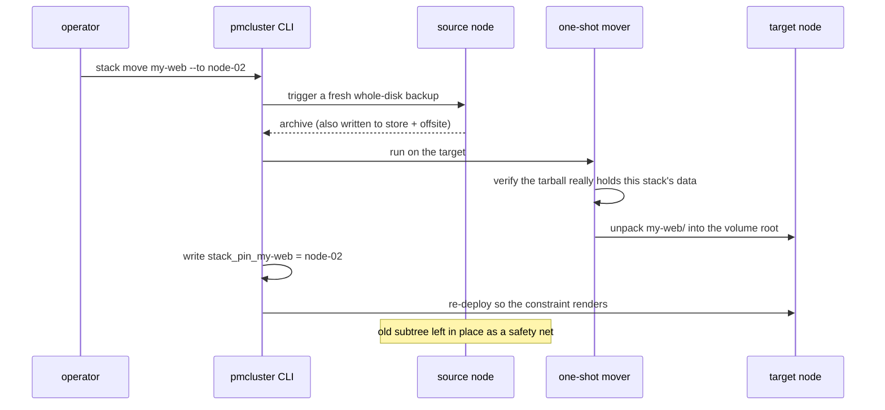
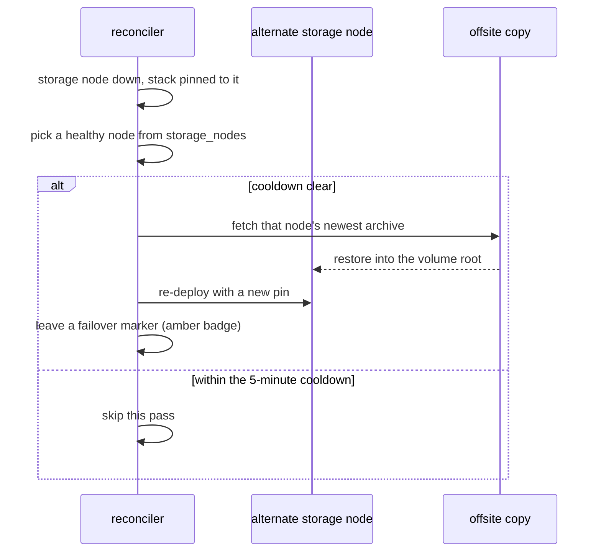
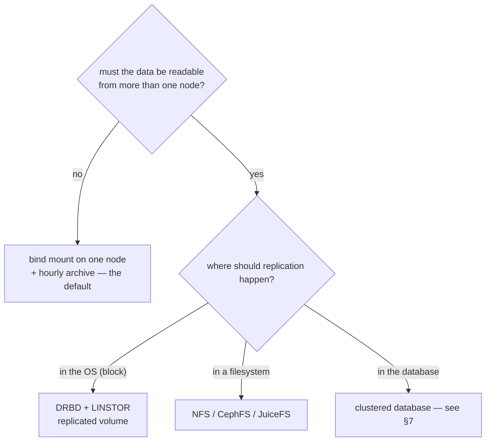
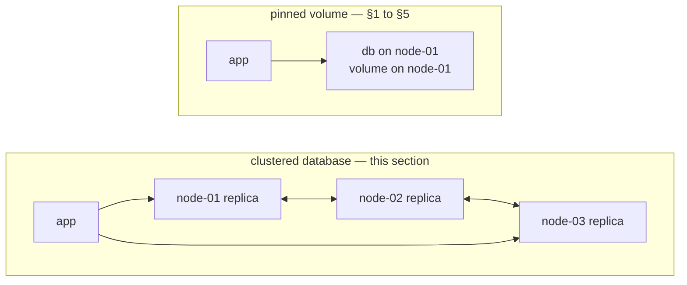

# Storage, backups, and moving data

This document answers one question: **where does my data live, and what happens to it when
something breaks?**

The short version, which the rest of this document earns:

> Every stateful service is placed on one storage node and stays there. An agent on that node
> tars the volume root every hour and writes the archive to two other places. You can restore
> that archive, and you can move the whole thing to another node without losing it.

If you would rather not think about any of this, jump to
[§7 — clustered databases](#7-clustered-databases-when-you-can-stop-caring). That is a real option,
and for many workloads it is the right one.

---

## 1. Where the bytes actually are

Everything a stack persists lands under one host directory: the **volume root**. It is a setting,
not a hardcoded path — `cluster settings set volume_root=…`, or `--volume-root` at setup. Blank
falls back to `/var/stack/data`.

Inside it, every app gets its own subtree, and each container gets a **bind mount** from that
subtree to the path the manifest asked for:



There is no storage driver, no CSI plugin, and no distributed filesystem in the path. The data is
a directory on a machine you own, at a path you can `ls`, `tar` and `rsync` yourself. That is a
deliberate constraint: it is why recovery does not depend on pmcluster being functional.

### Why one node owns a volume

A bind mount is local. If Swarm starts the container on a node where
`<volume_root>/<app>/<volume>` does not exist, the bind source is missing — the task either fails
to start or starts against an **empty directory** and the app comes up with no data.

That single fact is the reason placement matters at all, and the reason `placement: manager` is a
trap: it means *any* manager, so adding a second manager lets Swarm reschedule your database onto
a node whose volume root is empty.

---

## 2. How a stateful service gets its node

You do not choose the node. The platform resolves it, deterministically, before the compose is
rendered.

### 2.1 Name your storage nodes once

```bash
pmcluster join --storage-node …        # at join time
pmcluster node promote <hostname>      # later
pmcluster node demote  <hostname>      # and back out
```

Each does **two** things, and the second is the one that gets missed:

1. writes the hostname into the `storage_nodes` cluster setting — this drives **placement**;
2. stamps the `pmcluster.storage=true` Swarm node label — this is what the **backup agent**
   matches on, so backups only run where application data actually lives.

The leader is always a storage node: `cluster up` seeds it, and the list self-maintains — the
current leader is re-added, a former leader removed, and a node carrying the label but missing
from the setting is adopted on the next `cluster update`.

### 2.2 At deploy time, the platform resolves placement

Every manifest becomes an intermediate representation, and before the compose is written,
`PinResolver.ResolvePlacement` walks it. For each service **that holds a volume and left
`placement` empty**, `resolve()` applies this precedence:



The winner is rendered into the compose as a Swarm constraint (`node.hostname == <node>`), and
the service also carries an `io.pmcluster.node` label naming that node — which is what the
console's Services table and `pmcluster service ps` display, so you can always see where a
stateful service runs.

**Why a hash, and not an allocation table.** `roundRobinNode` is FNV-1a (32-bit) over the stack name, modulo the storage-node count
(`fnv.New32a()` in Go).
A counter would reshuffle every stack whenever you added one. Hashing the name means the same
stack always resolves to the same node, and a new stack never disturbs an existing one.
"Round robin" describes the *spread*, not the algorithm.

**Why that is safe to leave alone.** The resolution is a pure function of the stack name and the
`storage_nodes` setting. Two deploys of the same stack agree without coordinating, and there is no
allocation state to lose.

### 2.3 The override

Set `placement: <hostname>` and the resolver never touches the service. Use a hostname, not
`manager`/`worker`: those are role constraints, not pins, and they are how a "pinned" database
still ends up on an empty volume root.

### 2.4 What makes the layout hold

The DSL enforces the layout rather than documenting it:

- **Named volumes** are collected from service mounts (`db_data:/var/lib/postgresql/data`) and
  declared with `driver_opts: {type: none, o: bind, device: <root>/<app>/<name>}`. Docker's
  first-use ownership copy still runs, so Postgres and MySQL initialise correctly.
- **Host bind mounts** (`/host/config:/etc/app/config`) are relocated to `<root>/<app>/<basename>`.
  Raw `binds:` entries — `docker.sock`, `/etc/localtime`, sockets, device paths — are the
  deliberate exception and are emitted verbatim.
- **A per-node volume-repair loop** recreates missing bind-source directories for the services
  Swarm placed on that node, since a task whose bind source is missing never starts. It is a
  manager-side repair: the leader and standby managers run it, and a worker silently no-ops,
  because a worker cannot list services to find the ones pinned to it.

---

## 3. The backup

### 3.1 The agents

The backup stack (`platform: true`) runs **offen/docker-volume-backup:v2** as two agents.

**The volume agent** archives the volume root. How many replicas run, and where, follows from how
you configured storage:

| Condition | Where the volume agent runs |
|---|---|
| `storage_nodes` set | `mode: global`, constrained to `node.labels.pmcluster.storage == true` — one per storage node |
| `backup_all_nodes=true` | `mode: global` on **every** node (needed when data is not confined to storage nodes) |
| neither | a single replica pinned to the platform node / a manager |

It reads the volume root read-only (`<volume_root>:/backup/data:ro`) and writes archives to
`<backup_dir>:/archive` — `/var/stack/backup` on the host.

**The control-plane agent** runs only on the manager that holds `~/.pmcluster`, and archives the
platform's own state: `data.db`, `.encryption_key`, `config.yaml` and the rendered config tree.
It runs daily at `0 3 * * *` with a **30-day** retention and the `pmcluster-ctlplane-` filename
prefix, separate from volume archives so a lost manager disk does not mean a full re-bootstrap.

### 3.2 When a backup runs

| Trigger | When | Notes |
|---|---|---|
| Scheduled | `backup_cron`, default `0 * * * *` (hourly) | the newest archive is never more than an hour old — the storage-failover path restores exactly this |
| Pre-deploy | `backup_before_deploy: true` in the manifest | **opt-in per stack**; a failed run is recorded but does not block the deploy |
| Pre-deploy, strict | `backup_before_deploy` + `strict_backup: true` | a failed pre-deploy backup **aborts the deploy** |
| Manual | `pmcluster backup create` | |

### 3.3 What an archive is

A `tar.gz` of the volume root, named `backup-<nodeID>-<timestamp>.tar.gz`. It is an ordinary
tarball — you can extract your data out of it with `tar`, without pmcluster. Not inventing a
format is the point.

### 3.4 Every archive is written to two other places

This is the part that makes the rest of the story work:



Two things about this are deliberate and load-bearing:

**The store is on a non-storage node.** It is placed there explicitly — an explicit placement
bypasses the volume-service auto-pin — precisely so the durable copy lives in a different failure
domain from the data. If the backup sat beside the database, losing one node would lose both, and
storage failover (which restores *from the offsite copy*) could not exist.

**Writes to the store go over WebDAV, not S3.** The SeaweedFS S3 API does not auto-create a
bucket, so an S3-first write would fail on a fresh store; the WebDAV gateway creates
`/buckets/<bucket>` on first PUT. Both gateways serve the *same* namespace and run in the same
process, so this is a write-path detail, not a second copy.

The offsite leg is optional; when `backup_s3_*` is unset the agent writes only to the store.
offen's own pruning keeps both copies in lockstep on `backup_retention_days` (default **15**), so
there is no separate replicator service to operate.

### 3.5 How pmcluster knows what exists

Scheduled runs happen inside offen and never call the daemon. Counting only daemon-triggered runs
would show a fraction of your backups, so the daemon also **indexes** two sources: the local
archive dir, and the store (S3 `ListObjectsV2`, `backup-` prefix — control-plane archives
deliberately excluded). Each unique tarball gets exactly one row (a unique index on `filename`
makes re-scans idempotent), so `pmcluster backup list` shows scheduled *and* on-demand runs with
real archive paths. Discovery never deletes anything.

---

## 4. Getting it back

```bash
pmcluster backup list                 # every run, newest first, with status
pmcluster backup browse <id>          # what is inside those archives
pmcluster backup restore <id>         # put it back
```

Restore is **local-first**, and fails loudly rather than silently restoring nothing:



Details that prevent the classic accidents:

- **`--volume` is anchored to the stack.** On a stack-scoped run, `--volume db_data` can only ever
  match *that stack's* volume, so a bare name cannot pull another app's identically-named volume.
  On a whole-disk run a bare name matches every app, so scope it as `<app>/<volume>`.
- **The restore runs where the volume is.** A stack's volume lives on its pinned storage node, so
  when the CLI runs elsewhere the restore is routed there through the same store-transit mover used
  by `stack move`. When routing is impossible it says "this stack's volume lives on `<node>` — run
  the restore there" instead of unpacking data onto the wrong host. Control-plane archives are
  refused into the volume root.
- **A purge does not destroy your way back.** `cluster down --purge` first writes a restorable
  `purge-backup-<ts>.tar.gz` into the data dir and *keeps* it, and
  `pmcluster cluster reset --restore <archive>` extracts it before rebuilding the Swarm side.
  Plain `cluster reset` rebuilds networks, secrets, configs, platform stacks and storage labels
  from the local SQLite store — the DB is the source of truth and the Swarm is derived.

The control plane is restored by a different mechanism: on promotion, the leader restores the data
directory and encryption key from the Raft-replicated **survivor kit** (`pmcluster_state_*` Docker
configs, replicated to every manager by Swarm itself). The `pmcluster-ctlplane-*.tar.gz` archives
are the fallback, and a live database that is already current is never rewound by a restore.

---

## 5. Moving a stack to another node

### 5.1 `stack move` — the deliberate path

```bash
pmcluster stack move my-web --to node-02
```



The mover pulls the archive **object** from the store via the published loopback ingress
(`host.docker.internal:8333`) — no cross-node host ports, no firewall rules — and verifies the
tarball actually contains the stack's data before it touches the target. Where no store is
configured, a fallback ephemeral-HTTP mover serves the archive from the source host.

The `stack_pin_<stack>` setting it writes **outranks** the round-robin, so the reconciler will
never move the stack back on its own. The source node's subtree is intentionally left behind until
you prune it: a move is not an `mv`, and nothing is deleted for you.

### 5.2 Automatic failover

With `storage_failover=true` — which refuses to enable without an offsite `backup_s3_*`
destination, because it needs somewhere to restore *from* — the control loop handles a dead
storage node without you:



It restores the **failed node's** newest archive — never another node's — and the 5-minute
per-stack cooldown stops a persistently down node from causing a move storm. The marker is cleared
by `pmcluster stack ack <stack>` (you accept the new node) or by moving the stack back.

With the setting off, none of this happens: the loop **pauses** stacks pinned to a down node,
warns, and emits `pmcluster.storage.node.down` / `pmcluster.storage.failover.disabled` metrics.
That is the correct default for someone who has not configured an offsite destination — a paused
stack and an alert beats an automatic move with nowhere to restore from.

---

## 6. Other ways to run stateful services

The default assumes data lives on the node that runs the container. You can break that assumption
on purpose:



| Option | What it buys | What it costs |
|---|---|---|
| **One node + archive** (default) | no extra software; recovery by restore | a dead node means a restore before the app serves again |
| **DRBD + LINSTOR** | the volume follows the workload; the container can start on either node | synchronous block replication; a second disk per volume; the DRBD9 kernel module via DKMS, which rebuilds on every kernel update and needs headers |
| **NFS / CephFS / JuiceFS** | one namespace, no per-node copy | every write crosses the network; SQLite over NFS is a well-known way to corrupt a database; you now operate a filesystem and its metadata service |
| **External managed DB** | someone else runs replication and backups | not self-hosted — the thing this project exists to avoid |

**Why block replication is not the default.** LINSTOR is not merely absent from the platform; it
was considered and rejected. The costs are real: the LINSTOR controller is a JVM (~0.5–1 GB RAM)
that needs its own HA, each satellite adds memory plus the DRBD9 kernel module, and it provisions
LVM thin pools — which must never be auto-provisioned on a live disk. That is roughly a gigabyte
of RAM before a single byte of application data is stored, plus kernel-module maintenance, and it
still needs the backup pipeline on top, because a replicated device is a second copy to keep
consistent, not a point-in-time copy. For the deployments this project targets — a single VPS, or
a small swarm — placement plus an hourly archive plus `stack move` reaches the same recovery
outcomes at a fraction of the footprint. Revisit it only if a workload genuinely cannot tolerate a
minutes-scale restore window.

If you do run replicated disks yourself, set `backup_all_nodes=true`: data is no longer confined to
storage nodes, so the agent has to run wherever the volume can appear. Everything else in this
document — placement, backup, restore, move — works unchanged on top of it.

---

## 7. Clustered databases: when you can stop caring

Everything above answers *"what if the node holding my data dies?"* without running a distributed
filesystem. You can also answer it **inside the database**, and then most of this document stops
applying to you.

If the database replicates itself, losing a node is not a data-loss event: the other nodes already
have the data, and a replica that starts elsewhere catches up on its own.



**rqlite** — SQLite over Raft, and the closest fit for a SQLite shop: same SQL, same file format
underneath, but writes go through a Raft leader and replicate to followers. The catch is the
interface: rqlite speaks HTTP (`POST /db/execute?q=…`), so the app must talk to it over HTTP
rather than opening a SQLite file. The replication lives inside the engine, on node-local volumes,
so **no shared storage is needed**.

**CockroachDB** — distributed SQL, PostgreSQL wire-compatible, replicating ranges across nodes
with configurable survival goals. Each node uses its own local disk under the volume root, and
every node can act as an active gateway. It is the heaviest option here and genuinely wants three
nodes to be worth running.

**Same family:** MariaDB Galera (synchronous multi-master), PostgreSQL with Patroni or
CloudNativePG (streaming replication plus automatic failover), YugabyteDB, TiDB.

### What stops applying, what does not

- **Stops applying:** node affinity. When any replica can serve, "which node holds the volume"
  cannot lose data, so the placement pin stops being load-bearing and the auto-pin in §2 becomes
  a convenience rather than a safety property.
- **Stops applying:** restore-before-you-can-serve. A surviving replica serves immediately; you
  are not waiting on an archive.
- **Still applies:** the volume backup. The replicas still write to disk under the volume root, so
  the agent still archives them — and replication does **not** cover a bad migration, a dropped
  table, or an application that deletes the right rows. A `DELETE` replicates in milliseconds.
- **Costs more:** three nodes minimum, real CPU and memory per node, and a database you now
  operate. For one small app on one $5 VPS, a pinned volume and an hourly archive is the better
  engineering.

**Replication protects availability. A backup protects your data.** Adopt a clustered database and
you can stop worrying about the first. Keep the hourly archive for the second.

---

## 8. Reference

### Storage options at a glance

| Engine / option | Topology | Best for | Safe for a DB? | Complexity |
| :--- | :--- | :--- | :---: | :---: |
| Local mount + pmcluster backups | single node | default; SQLite, Postgres, anything with a volume | **yes** | minimal |
| rqlite / CockroachDB / Galera / Patroni | multi-node | DB-level replication, any node can serve | **yes** | low–medium |
| Host NFS / GlusterFS / CephFS | multi-node, LAN | concurrent shared file uploads (RWX) | **no** | low–medium |
| JuiceFS / SeaweedFS (S3-backed FS) | WAN / multi-region | shared storage without a LAN | single-writer only | medium |
| DRBD + LINSTOR | multi-node | workloads that cannot tolerate a restore window | yes | high — bring it yourself |

The SeaweedFS instance pmcluster ships is a **backup store**, not a shared data plane for
databases; do not point a database at it.

### The settings that drive all of this

| Setting | Default | What it does |
|---|---|---|
| `volume_root` | `/var/stack/data` | the host root every container volume is bind-mounted under |
| `storage_nodes` | leader's hostname | which nodes stateful stacks may land on |
| `storage_failover` | `false` | automatic move off a dead storage node (needs `backup_s3_*`) |
| `backup_cron` | `0 * * * *` | the volume agent's schedule |
| `backup_retention_days` | `15` | prune window for archives and audit rows |
| `backup_all_nodes` | `false` | run the agent everywhere (needed with replicated disks) |
| `backup_store_on` | `""` = auto | where the in-cluster store runs |
| `backup_s3_*` | unset | the offsite destination |
| `platform_node` | the leader | pins platform services — which are stateful too |

### Quickstart: a database stack that is safe by default

```yaml
app: myapp
env: production
domain: myapp.example.com
services:
  db:
    image: postgres:16-alpine
    volumes:
      - db_data:/var/lib/postgresql/data   # no placement: placed for you
    healthcheck: { type: pg_isready }
  web:
    image: ghcr.io/acme/myapp
    expose: { port: 8080, host: myapp.example.com }
    # stateless: no volume, so nothing to place or back up
```

```bash
pmcluster join --storage-node --hostname node-01   # name your storage nodes once
pmcluster deploy ./app.yaml
pmcluster backup list                              # the hourly archives appear here
```

The hourly agent backs up `<volume_root>`; `myapp` rides along automatically. Pre-deploy snapshots
are opt-in per stack via `backup_before_deploy: true`, plus `strict_backup: true` to abort the
deploy if that snapshot fails. By default Postgres initialises correctly because named volumes
become bind mounts with Docker's first-use ownership copy intact.

**Bringing your own backup tooling** (restic, pgBackRest, Litestream) is fine as a replacement for
the shipped agent, but it is *your* service: discovery, retention, restore, move and failover only
know about archives the shipped agents write — the local archive dir and the store/offsite objects.
Bring your own, and you bring your own restore story.

### Where to check a claim in this document

- placement resolution — `pmcluster/internal/stacks/placement.go`
- storage nodes, labels and the leader's membership — `pmcluster/internal/cli/node.go`,
  `pmcluster/internal/cluster/update.go`
- the agents, the store and the double write — `pmcluster/internal/cluster/embeds/backup-stack.yml`
- archive records and discovery — `pmcluster/migrations/0005_backups.sql`,
  `0018_backup_filename.sql`, `pmcluster/internal/backups/local.go`
- restore, `--volume`, `--from-s3` — `pmcluster/internal/cli/backup.go`,
  `pmcluster/internal/backups/browse.go`
- move and failover — `pmcluster/internal/stacks/move.go`,
  `pmcluster/internal/reconcile/reconcile.go`
- the mover's transit path — `pmcluster/internal/stacks/move_store.go`
- control-plane recovery — `pmcluster/internal/cli/leader.go`
