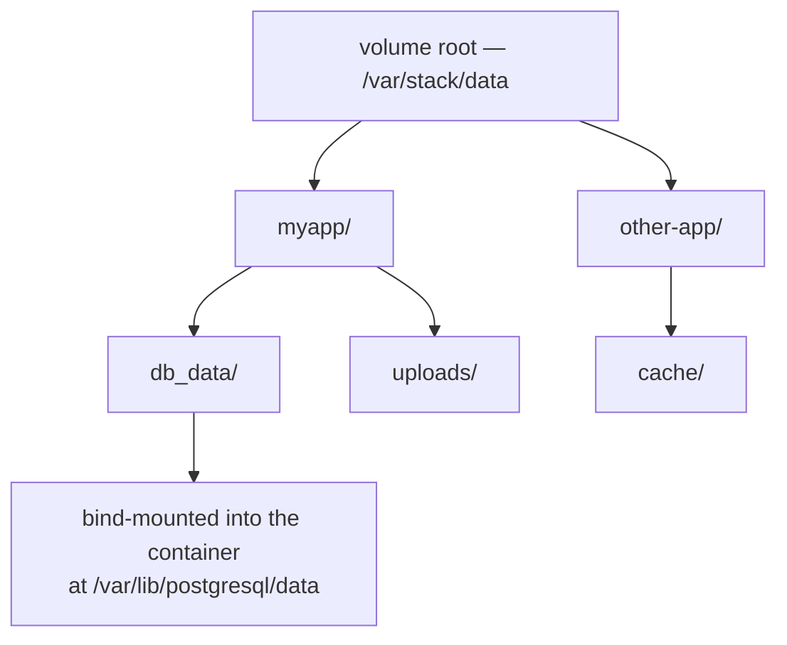
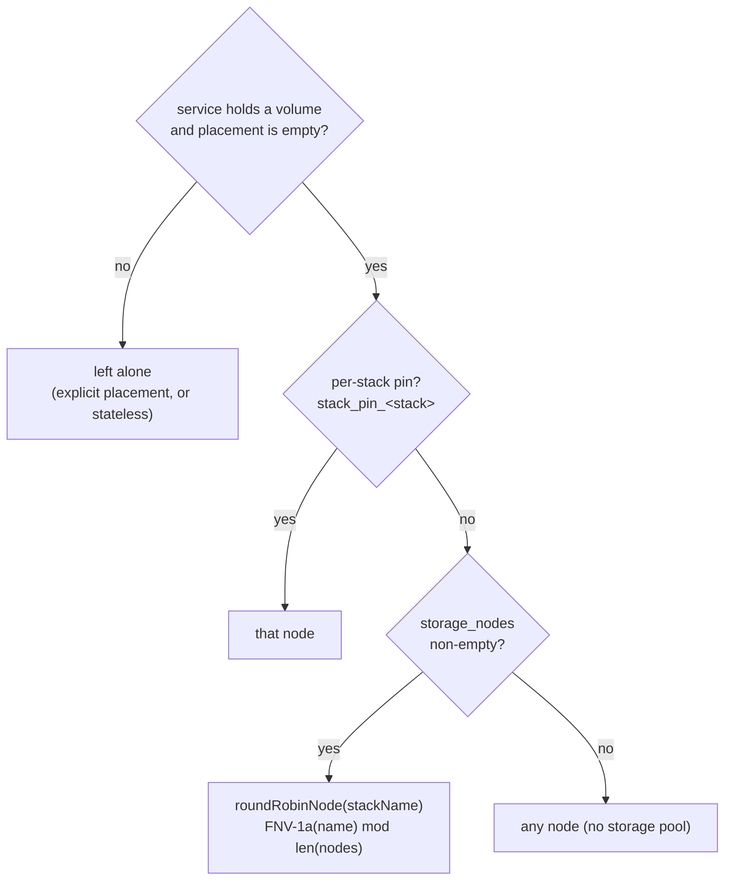
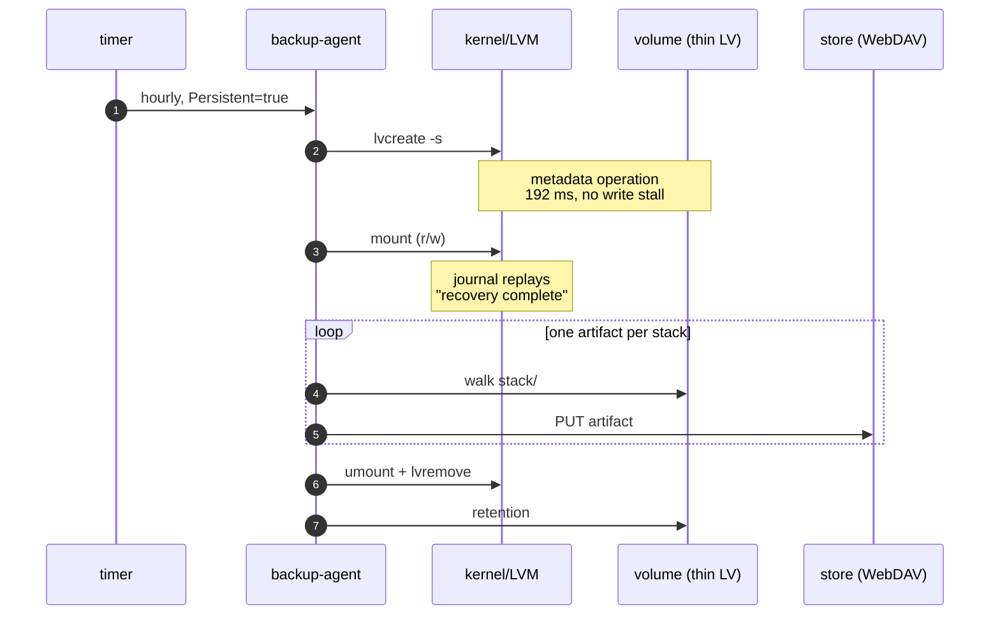
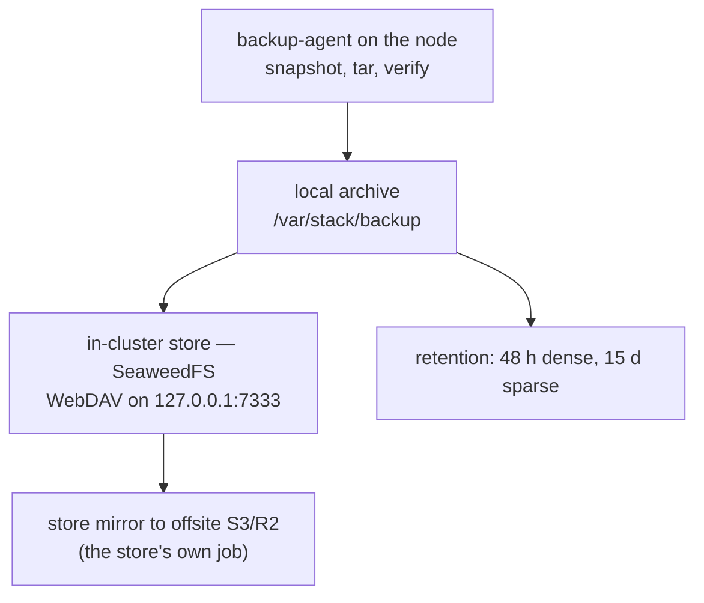
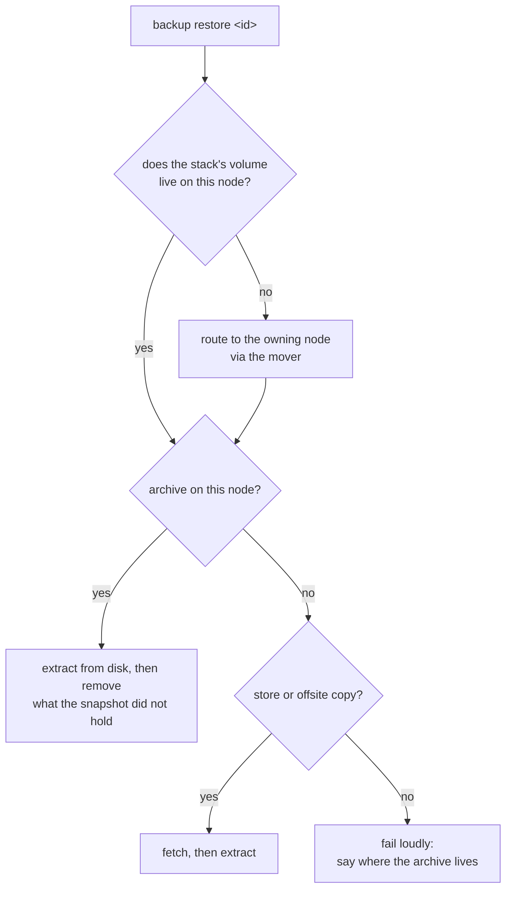
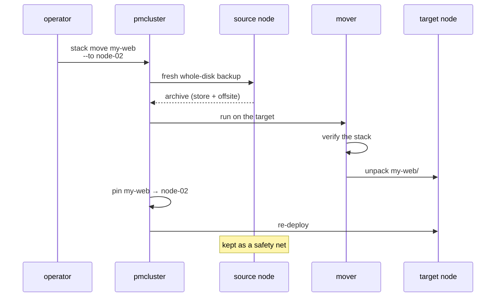
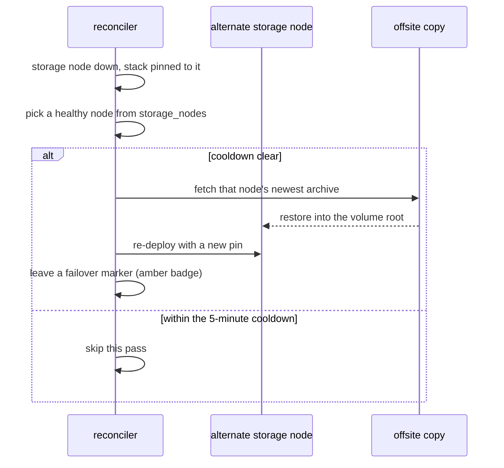
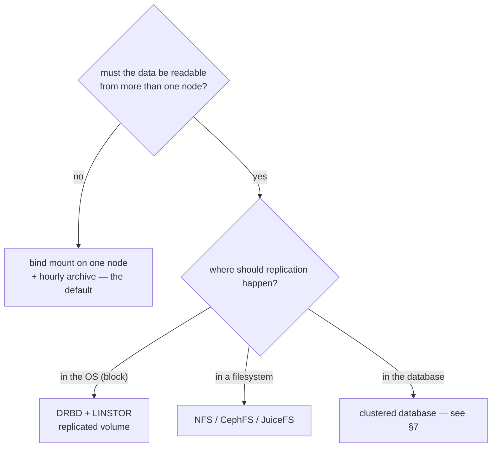
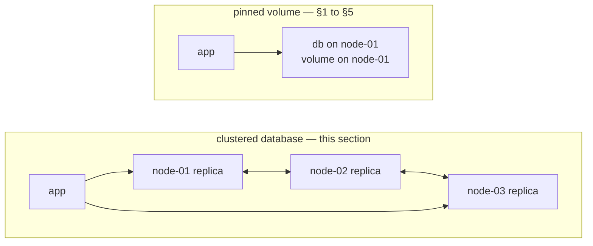

# Storage, backups, and moving data

This document answers one question: **where does my data live, and what happens to it when
something breaks?**

The short version, which the rest of this document earns:

> Every stateful service is placed on one storage node and stays there. An agent on that node
> tars the volume root every hour and writes the archive to two other places. You can restore
> that archive, and you can move the whole thing to another node without losing it.

If you would rather not think about any of this, jump to
[§7 — clustered databases](#7-clustered-databases-when-you-can-stop-caring). That is a real option,
and for many workloads it is the right one.

---

## 1. Where the bytes actually are

Everything a stack persists lands under one host directory: the **volume root**. It is a setting,
not a hardcoded path — `cluster settings set volume_root=…`, or `--volume-root` at setup. Blank
falls back to `/var/stack/data`.

Inside it, every app gets its own subtree, and each container gets a **bind mount** from that
subtree to the path the manifest asked for:



There is no storage driver, no CSI plugin, and no distributed filesystem in the path. The data is
a directory on a machine you own, at a path you can `ls`, `tar` and `rsync` yourself. That is a
deliberate constraint: it is why recovery does not depend on pmcluster being functional.

### Why one node owns a volume

A bind mount is local. If Swarm starts the container on a node where
`<volume_root>/<app>/<volume>` does not exist, the bind source is missing — the task either fails
to start or starts against an **empty directory** and the app comes up with no data.

That single fact is the reason placement matters at all, and the reason `placement: manager` is a
trap: it means *any* manager, so adding a second manager lets Swarm reschedule your database onto
a node whose volume root is empty.

---

## 2. How a stateful service gets its node

**You do not have to pin anything.** A service that holds a volume is placed onto a storage node
for you, and the placement is stable. `placement:` exists to *override* that, not to make it work.
The rest of this section is how — and why it is built that way.

You do not choose the node. The platform resolves it, deterministically, before the compose is
rendered.

### 2.1 Name your storage nodes once

```bash
pmcluster join --storage-node …        # at join time
pmcluster node promote <hostname>      # later
pmcluster node demote  <hostname>      # and back out
```

Each does **two** things, and the second is the one that gets missed:

1. writes the hostname into the `storage_nodes` cluster setting — this drives **placement**;
2. stamps the `pmcluster.storage=true` Swarm node label — this is what the **backup agent**
   matches on, so backups only run where application data actually lives.

The leader is always a storage node: `cluster up` seeds it, and the list self-maintains — the
current leader is re-added, a former leader removed, and a node carrying the label but missing
from the setting is adopted on the next `cluster update`.

### 2.2 At deploy time, the platform resolves placement

Every manifest becomes an intermediate representation, and before the compose is written,
`PinResolver.ResolvePlacement` walks it. For each service **that holds a volume and left
`placement` empty**, `resolve()` applies this precedence:



The winner is rendered into the compose as a Swarm constraint (`node.hostname == <node>`), and
the service also carries an `io.pmcluster.node` label naming that node — which is what the
console's Services table and `pmcluster service ps` display, so you can always see where a
stateful service runs.

**Why a hash, and not an allocation table.** `roundRobinNode` is FNV-1a (32-bit) over the stack name, modulo the storage-node count
(`fnv.New32a()` in Go).
A counter would reshuffle every stack whenever you added one. Hashing the name means the same
stack always resolves to the same node, and a new stack never disturbs an existing one.
"Round robin" describes the *spread*, not the algorithm.

**Why the hash alone is not enough.** `roundRobinNode` is pure, but it is a pure function of the
stack name *and the list as it stands today*: the modulo changes the moment a node is added or
removed, so every unpinned stack whose index moves resolves somewhere new. On a stateless service
that is invisible. On a stateful one it is a relocation, because the volume is a host path — a
service that resolves elsewhere comes up beside an empty directory rather than its own data.
"There is no allocation state to lose" was the assumption that made this look safe, and it is
wrong: the assignment *is* state, and it has to be recorded.

**So the assignment is written once.** Two deploys of an unpinned stack still agree without
coordinating, because both read the same list — but that agreement is with today's list, not with
the deploy that created the app. When an app holding a volume is therefore placed for the first
time without a pin of its own, the resolved node is recorded as `stack_pin_<stack>`. The
resolver's first branch answers from then on, and the round-robin only decides the placement of
stacks that have never been placed. Adding a storage node gives the new capacity to *new* stacks
and touches nothing already running, which is the contract: a stack moves when you move it, or
when a failover moves it.

### 2.3 The override

Set `placement: <hostname>` and the resolver never touches the service. Use a hostname, not
`manager`/`worker`: those are role constraints, not pins, and they are how a "pinned" database
still ends up on an empty volume root.

### 2.4 What makes the layout hold

The DSL enforces the layout rather than documenting it:

- **Named volumes** are collected from service mounts (`db_data:/var/lib/postgresql/data`) and
  declared with `driver_opts: {type: none, o: bind, device: <root>/<app>/<name>}`. Docker's
  first-use ownership copy still runs, so Postgres and MySQL initialise correctly.
- **Host bind mounts** (`/host/config:/etc/app/config`) are relocated to `<root>/<app>/<basename>`.
  Raw `binds:` entries — `docker.sock`, `/etc/localtime`, sockets, device paths — are the
  deliberate exception and are emitted verbatim.
- **A per-node volume-repair loop** recreates missing bind-source directories for the services
  Swarm placed on that node, since a task whose bind source is missing never starts. It is a
  manager-side repair: the leader and standby managers run it, and a worker silently no-ops,
  because a worker cannot list services to find the ones pinned to it.

---

## 3. The backup

### 3.1 Where the volume comes from

None of the rest of this chapter is possible on a plain directory: a copy of a
directory is a file-by-file walk of a tree the applications are still writing to.
So the first thing that has to be true is that `<volume_root>` is a mount of its
own snapshot-capable filesystem.

```
app-data.img                  sparse file, 50% of free space (8 GiB..128 GiB)
 └─ /dev/loopN                loop device, found by file not by number
    └─ vg-pmcluster           # volume group (LVM)
       ├─ pool                 thin pool: file size minus 1 GiB
       └─ data                 thin volume: 80% of the pool
          └─ /var/stack/data   ext4, noatime
```

```bash
pmcluster storage status       # what this node can do, and why not
sudo pmcluster storage provision    # empty node: build it
sudo pmcluster storage migrate      # existing node: build, copy, verify, switch
sudo pmcluster storage grow --size 64G
```

The data volume is deliberately smaller than its pool: each run allocates pool
blocks for the snapshot's divergent writes, and a volume that already fills its
pool leaves the snapshot nowhere to go. The missing fifth is that room, and the
agent aborts a run at 80% pool usage rather than ship a snapshot the kernel may
invalidate mid-copy.

`setup` asks once and provisions before the cluster deploys; `join
--storage-node` provisions the node being added; `cluster up` refuses to deploy
when a backing file exists but nothing is mounted — that state is
indistinguishable from a fresh node by `ls`, and deploying onto it runs every
stack on an empty directory.

### 3.2 The schedule belongs to the control plane, not to the timer

`pmcluster-backup.timer` fires every hour and means nothing on its own. Before
each run the agent reads its policy — `/etc/pmcluster/backup.conf`, mode 0600 —
and obeys it:

| setting | effect |
|---|---|
| `backup_enabled` | `false` ⇒ the agent exits without freezing anything |
| `backup_cron` | a run happens only when the current minute matches |
| `backup_store_on` | `off` ⇒ no in-cluster store is deployed or written |
| `backup_s3_*` | a complete set ⇒ artifacts are also uploaded offsite |

The file is written by `pmcluster backup-agent install` from the cluster's
settings, and the same values are editable from the console and the CLI
(`pmcluster backup enable`, `backup disable`, `backup schedule "0 2 * * *"`).

**There is no endpoint and no cross-node call.** An earlier design had the agent
ask a manager over HTTP; that turned into an unauthenticated port on the private
plane, and — worse — the response carried the offsite bucket key, which any
container on the overlay could have read. The policy file removes the question
entirely: a node never asks another node for permission.

**Why a file and not a read of the node's own store?** Managers carry the full
settings in their control-plane database, and a promoted leader keeps them (the
survivor kit restores the newest `pmcluster_state_*` config on promotion, and a
standby's `data.db` holds the same rows). **Workers do not**: their copy is as old
as their last restore from the daily archive, so a worker reading its own store
silently falls back to hourly defaults. That is why the policy is a file the
platform writes rather than a setting the node looks up.

**The timer is a heartbeat. Do not edit it.** Changing its calendar changes
nothing — the decision comes from the policy above. The run lock belongs to the
agent, not the unit, so a forced run and the hourly run can never overlap.

### 3.3 The producer is a node-local agent, not a Swarm service

The per-volume archiver this platform used to ship (offen/docker-volume-backup)
is gone. It tarred a live directory, so one growing SQLite file could abort a
node's whole hour, and that is not a bug to fix but a design to replace.

What runs instead is a privileged one-shot on each node,
`pmcluster-backup.timer` → `pmcluster-backup.service` → `pmcluster backup-agent
run`. It runs on the host rather than in a Swarm task because a task can be
rescheduled mid-run, cannot hold a lock across the run, and has no ordering
against the filesystem it is archiving.



The whole run, from provisioning through restore, is drawn in
[`backup-agent-flow.md`](backup-agent-flow.md) — including what is not built.

There is no freeze, and that is deliberate.

An earlier version ran `fsfreeze -f` around the snapshot. It was removed after it
took a production node down: the freeze flushes every dirty page and blocks
writers until the disk acknowledges them, which is unbounded and cannot be
cancelled. On a node whose pool is a loop file on the root disk that flush
competes with Docker, containerd, journald and sshd for one device. Measured:
**19m29s** of write stall, kernel hung-task reports, dockerd missing its swarm
heartbeat, and every service rescheduled. The same code on an idle node froze for
**216 ms** — the cost is a property of write rate, not a constant.

What the freeze bought was filesystem-metadata consistency, and the filesystem
already guarantees that itself: a journaling filesystem keeps "the on-disk state is
always recoverable" true at every instant, so a thin snapshot — a metadata
operation, **192 ms measured** — captures a recoverable state. The copy is mounted
**read-write** so its journal replays, exactly as it would after a power cut. That
is crash consistency, and it is the same guarantee cloud volume snapshots give.

Databases do not need anything more: PostgreSQL, InnoDB and SQLite are crash-safe
by design and replay their own redo on open. The one invariant is that the redo
material must sit in the **same snapshot** as the data — `pg_wal`, InnoDB redo and
the SQLite `-wal` file must live in the stack's own volume, never on a separate
volume or outside the pool. A database split across two snapshotted volumes is the
single silent-unrestorable case, and it is a volume-layout rule rather than an
engine plugin.

The honest trade: this is crash consistency, not application consistency. A volume
mounted `data=writeback`, or a store that writes multi-file state without fsync
(Redis with `appendfsync no`), can come back needing a documented repair step.
Stacks that need sub-hour RPO get WAL shipping as a per-stack option; the
mechanism above stays engine-agnostic.

**A run refuses rather than degrades.** If the volume root is not a mount of the
expected logical volume — a fresh node, or one whose boot ordering failed — the
agent exits non-zero and writes no artifact. It never falls back to tarring the
live tree; that fallback is the failure this design exists to remove.

### 3.4 What an artifact is

One `tar.gz` per stack, per run: `backup-<nodeID>-<timestamp>-stack-<stack>.tar.gz`,
members under `backup/data/<stack>/…`. An ordinary tarball — `tar -xzf` it
without pmcluster. Not inventing a format is the point.

Beside it, a `manifest.json` carries the sha256, size, which node took it, which
snapshot it came from, and the verification verdict. Verification opens the
archive and checks what can be checked from the host:

| engine | what is verified |
|---|---|
| SQLite | `PRAGMA integrity_check` on every database in the artifact |
| PostgreSQL | control file and WAL present — recognised, not validated |
| MySQL / MariaDB | InnoDB system tablespace, data dictionary, redo log, Aria control file — recognised, not validated |

That distinction is deliberate: a green tick that claimed to validate a Postgres
cluster from the host would be a lie the console then repeats.

### 3.5 Two write legs, and who owns each



**The local copy is written first.** An artifact on disk says nothing about the
store leg, which is why the run reports per stack and a shipping failure marks
that stack failed while leaving the artifact intact and restorable.

**The store is reached over the node's own loopback.** The agent is a host
process, so it cannot resolve the overlay name `backup_seaweedfs`; the store's
WebDAV gateway is published on the routing mesh and the agent PUTs to
`127.0.0.1:7333` with the store's credentials, which live in
`/etc/pmcluster/backup.env` (mode 0600) rather than in the world-readable unit.

**The store sits on a non-storage node**, by explicit placement, so the durable
copy lives in a different failure domain from the data. That placement is
derived, not configured: adding a storage label to the last non-storage worker
moves the store onto the platform node, and because the store's volume is
node-local its history does not follow. Worth an explicit setting.

**Offsite is the agent's second leg, optional and independent.** The agent
uploads the artifact it just verified straight to an S3-compatible bucket
(IONOS/R2/AWS), signed with SigV4, with the same bounds as any other network
call. The in-cluster store and the offsite bucket are separately configurable:
either, both, or neither.

**Every stack records where its artifact went.** The run's per-stack record
carries `where`: `node:<artifact>` always, plus `store:` and `s3:` when those legs
ran. Once a backup can live in three places, "succeeded" is not an answer to
"where is the copy of this stack".

### 3.6 Retention

Each run prunes its own archive directory: everything for 48 hours, then one
artifact per calendar day until 15 days, judged per stack. The newest copies of a
stack are never deleted, and whole-node archives from the previous agent are left
alone unless asked (`--legacy`) — on a fleet mid-cutover those are the only
backups that exist.

```bash
pmcluster backup prune --dry-run
pmcluster backup prune --keep-hours 72 --keep-days 30
```

### 3.7 The control-plane agent

Unchanged, and separate: `backup_control-plane-backup` still runs only on the
manager holding `~/.pmcluster`, archiving `data.db`, `.encryption_key`,
`config.yaml` and the rendered config tree. Daily at `0 3 * * *`, 30-day
retention, `pmcluster-ctlplane-` prefix — so a lost manager disk is not a full
re-bootstrap.

### 3.8 How pmcluster knows what exists

The agent writes artifacts; the daemon **indexes** them. Discovery reads the
local archive dir and the store (S3 `ListObjectsV2`, `backup-` prefix,
control-plane archives deliberately excluded), and gives each unique tarball
exactly one row, so `pmcluster backup list` shows scheduled and on-demand runs
with real paths. Discovery never deletes anything.

**A discovered run is not automatically a success.** Finding an archive proves
the run produced *something*, not that every destination received it. When an
offsite target is configured, discovery checks it for each newly discovered
artifact and records:

| status | meaning |
|---|---|
| `succeeded` | on disk, and the configured offsite bucket holds its copy |
| `offsite-missing` | on disk, offsite copy absent — or the bucket could not be read at all. The row's note says which |
| `succeeded` | nothing configured offsite, so there is nothing to verify |

`offsite-missing` is deliberately not `failed`: the artifact is intact and
restorable. It exists so an offsite outage cannot read as a clean backup history.

---

## 4. Getting it back

```bash
pmcluster backup list                 # every run, newest first, with status
pmcluster backup browse <id>          # what is inside those archives
pmcluster backup restore <id>         # put it back
```

Restore is **local-first**, and fails loudly rather than silently restoring nothing. A run
recorded `offsite-missing` is restorable: only its offsite *copy* is missing, while the archive on
disk is the same snapshot. Refusing those would block a restore during the one incident — an offsite
outage — where an operator is most likely to need one.



Details that prevent the classic accidents:

- **`--volume` is anchored to the stack.** On a stack-scoped run, `--volume db_data` can only ever
  match *that stack's* volume, so a bare name cannot pull another app's identically-named volume.
  On a whole-disk run a bare name matches every app, so scope it as `<app>/<volume>`.
- **A restore replaces, it does not merge.** Once the archives are extracted, entries under the restored
  scope that the snapshot did not hold are removed, so the volume ends up as the snapshot captured it. For a
  database that is the difference between a consistent rollback and a directory that is a union of two
  moments: a lock file or a log segment written *after* the snapshot describes a different point in time than
  the data pages beside it. The scope comes from the snapshot, never from the destination — an app deployed
  after the backup is not in the archive and is therefore untouched, and `--volume` confines both the restore
  and the removal to a single volume. Ordering is deliberate: the snapshot is read before anything is
  written and everything is extracted before anything is removed, so a restore that dies on a truncated
  archive leaves the volume as it was instead of half-empty. *(Whether a restore should merge instead, or
  offer both, is still an open decision.)*
- **The restore runs where the volume is.** A stack's volume lives on its pinned storage node, so
  when the CLI runs elsewhere the restore is routed there through the same store-transit mover used
  by `stack move`. When routing is impossible it says "this stack's volume lives on `<node>` — run
  the restore there" instead of unpacking data onto the wrong host. Control-plane archives are
  refused into the volume root.
- **A purge does not destroy your way back.** `cluster down --purge` first writes a restorable
  `purge-backup-<ts>.tar.gz` into the data dir and *keeps* it, and
  `pmcluster cluster reset --restore <archive>` extracts it before rebuilding the Swarm side.
  Plain `cluster reset` rebuilds networks, secrets, configs, platform stacks and storage labels
  from the local SQLite store — the DB is the source of truth and the Swarm is derived.

The control plane is restored by a different mechanism: on promotion, the leader restores the data
directory and encryption key from the Raft-replicated **survivor kit** (`pmcluster_state_*` Docker
configs, replicated to every manager by Swarm itself). The `pmcluster-ctlplane-*.tar.gz` archives
are the fallback, and a live database that is already current is never rewound by a restore.

---

## 5. Moving a stack to another node

### 5.1 `stack move` — the deliberate path

```bash
pmcluster stack move my-web --to node-02
```



The mover pulls the archive **object** from the store via the published loopback ingress
(`host.docker.internal:8333`) — no cross-node host ports, no firewall rules — and verifies the
tarball actually contains the stack's data before it touches the target. Where no store is
configured, a fallback ephemeral-HTTP mover serves the archive from the source host.

The `stack_pin_<stack>` setting it writes **outranks** the round-robin, so the reconciler will
never move the stack back on its own. This is not a special case for moved stacks: every stateful
stack carries a pin from its first placement, and a move rewrites it to the new node. The source node's subtree is intentionally left behind until
you prune it: a move is not an `mv`, and nothing is deleted for you.

### 5.2 Automatic failover

With `storage_failover=true` — which refuses to enable without an offsite `backup_s3_*`
destination, because it needs somewhere to restore *from* — the control loop handles a dead
storage node without you:



It restores the **failed node's** newest archive — never another node's — and the 5-minute
per-stack cooldown stops a persistently down node from causing a move storm. The marker is cleared
by `pmcluster stack ack <stack>` (you accept the new node) or by moving the stack back.

With the setting off, none of this happens: the loop **pauses** stacks pinned to a down node,
warns, and emits `pmcluster.storage.node.down` / `pmcluster.storage.failover.disabled` metrics.
That is the correct default for someone who has not configured an offsite destination — a paused
stack and an alert beats an automatic move with nowhere to restore from.

---

## 6. Other ways to run stateful services

The default assumes data lives on the node that runs the container. You can break that assumption
on purpose:



| Option | What it buys | What it costs |
|---|---|---|
| **One node + archive** (default) | no extra software; recovery by restore | a dead node means a restore before the app serves again |
| **DRBD + LINSTOR** | the volume follows the workload; the container can start on either node | synchronous block replication; a second disk per volume; the DRBD9 kernel module via DKMS, which rebuilds on every kernel update and needs headers |
| **NFS / CephFS / JuiceFS** | one namespace, no per-node copy | every write crosses the network; SQLite over NFS is a well-known way to corrupt a database; you now operate a filesystem and its metadata service |
| **External managed DB** | someone else runs replication and backups | not self-hosted — the thing this project exists to avoid |

**Why block replication is not the default.** LINSTOR is not merely absent from the platform; it
was considered and rejected. The costs are real: the LINSTOR controller is a JVM (~0.5–1 GB RAM)
that needs its own HA, each satellite adds memory plus the DRBD9 kernel module, and it provisions
LVM thin pools — which must never be auto-provisioned on a live disk. That is roughly a gigabyte
of RAM before a single byte of application data is stored, plus kernel-module maintenance, and it
still needs the backup pipeline on top, because a replicated device is a second copy to keep
consistent, not a point-in-time copy. For the deployments this project targets — a single VPS, or
a small swarm — placement plus an hourly archive plus `stack move` reaches the same recovery
outcomes at a fraction of the footprint. Revisit it only if a workload genuinely cannot tolerate a
minutes-scale restore window.

If you do run replicated disks yourself, set `backup_all_nodes=true`: data is no longer confined to
storage nodes, so the agent has to run wherever the volume can appear. Everything else in this
document — placement, backup, restore, move — works unchanged on top of it.

---

## 7. Clustered databases: when you can stop caring

Everything above answers *"what if the node holding my data dies?"* without running a distributed
filesystem. You can also answer it **inside the database**, and then most of this document stops
applying to you.

If the database replicates itself, losing a node is not a data-loss event: the other nodes already
have the data, and a replica that starts elsewhere catches up on its own.



**rqlite** — SQLite over Raft, and the closest fit for a SQLite shop: same SQL, same file format
underneath, but writes go through a Raft leader and replicate to followers. The catch is the
interface: rqlite speaks HTTP (`POST /db/execute?q=…`), so the app must talk to it over HTTP
rather than opening a SQLite file. The replication lives inside the engine, on node-local volumes,
so **no shared storage is needed**.

**CockroachDB** — distributed SQL, PostgreSQL wire-compatible, replicating ranges across nodes
with configurable survival goals. Each node uses its own local disk under the volume root, and
every node can act as an active gateway. It is the heaviest option here and genuinely wants three
nodes to be worth running.

**Same family:** MariaDB Galera (synchronous multi-master), PostgreSQL with Patroni or
CloudNativePG (streaming replication plus automatic failover), YugabyteDB, TiDB.

### What stops applying, what does not

- **Stops applying:** node affinity. When any replica can serve, "which node holds the volume"
  cannot lose data, so the placement pin stops being load-bearing and the auto-pin in §2 becomes
  a convenience rather than a safety property.
- **Stops applying:** restore-before-you-can-serve. A surviving replica serves immediately; you
  are not waiting on an archive.
- **Still applies:** the volume backup. The replicas still write to disk under the volume root, so
  the agent still archives them — and replication does **not** cover a bad migration, a dropped
  table, or an application that deletes the right rows. A `DELETE` replicates in milliseconds.
- **Costs more:** three nodes minimum, real CPU and memory per node, and a database you now
  operate. For one small app on one $5 VPS, a pinned volume and an hourly archive is the better
  engineering.

**Replication protects availability. A backup protects your data.** Adopt a clustered database and
you can stop worrying about the first. Keep the hourly archive for the second.

---

## 8. Reference

### Storage options at a glance

| Engine / option | Topology | Best for | Safe for a DB? | Complexity |
| :--- | :--- | :--- | :---: | :---: |
| Local mount + pmcluster backups | single node | default; SQLite, Postgres, anything with a volume | **yes** | minimal |
| rqlite / CockroachDB / Galera / Patroni | multi-node | DB-level replication, any node can serve | **yes** | low–medium |
| Host NFS / GlusterFS / CephFS | multi-node, LAN | concurrent shared file uploads (RWX) | **no** | low–medium |
| JuiceFS / SeaweedFS (S3-backed FS) | WAN / multi-region | shared storage without a LAN | single-writer only | medium |
| DRBD + LINSTOR | multi-node | workloads that cannot tolerate a restore window | yes | high — bring it yourself |

The SeaweedFS instance pmcluster ships is a **backup store**, not a shared data plane for
databases; do not point a database at it.

### The settings that drive all of this

| Setting | Default | What it does |
|---|---|---|
| `volume_root` | `/var/stack/data` | the host root every container volume is bind-mounted under |
| `storage_nodes` | leader's hostname | which nodes stateful stacks may land on |
| `storage_failover` | `false` | automatic move off a dead storage node (needs `backup_s3_*`) |
| `backup_cron` | `0 * * * *` | the volume agent's schedule |
| `backup_retention_days` | `15` | prune window for archives and audit rows |
| `backup_all_nodes` | `false` | run the agent everywhere (needed with replicated disks) |
| `backup_store_on` | `""` = auto | where the in-cluster store runs |
| `backup_s3_*` | unset | the offsite destination |

### Quickstart: a database stack that is safe by default

```yaml
app: myapp
env: production
domain: myapp.example.com
services:
  db:
    image: postgres:16-alpine
    volumes:
      - db_data:/var/lib/postgresql/data   # no placement: placed for you
    healthcheck: { type: pg_isready }
  web:
    image: ghcr.io/acme/myapp
    expose: { port: 8080, host: myapp.example.com }
    # stateless: no volume, so nothing to place or back up
```

```bash
pmcluster join --storage-node --hostname node-01   # name your storage nodes once
pmcluster deploy ./app.yaml
pmcluster backup list                              # the hourly archives appear here
```

The hourly agent backs up `<volume_root>`; `myapp` rides along automatically. Pre-deploy snapshots
are opt-in per stack via `backup_before_deploy: true`, plus `strict_backup: true` to abort the
deploy if that snapshot fails. By default Postgres initialises correctly because named volumes
become bind mounts with Docker's first-use ownership copy intact.

**Bringing your own backup tooling** (restic, pgBackRest, Litestream) is fine as a replacement for
the shipped agent, but it is *your* service: discovery, retention, restore, move and failover only
know about archives the shipped agents write — the local archive dir and the store/offsite objects.
Bring your own, and you bring your own restore story.

### Where to check a claim in this document

- placement resolution — `pmcluster/internal/stacks/placement.go`
- storage nodes, labels and the leader's membership — `pmcluster/internal/cli/node.go`,
  `pmcluster/internal/cluster/update.go`
- the agents, the store and the double write — `pmcluster/internal/cluster/embeds/backup-stack.yml`
- archive records and discovery — `pmcluster/migrations/0005_backups.sql`,
  `0018_backup_filename.sql`, `pmcluster/internal/backups/local.go`
- restore, `--volume`, `--from-s3` — `pmcluster/internal/cli/backup.go`,
  `pmcluster/internal/backups/browse.go`
- move and failover — `pmcluster/internal/stacks/move.go`,
  `pmcluster/internal/reconcile/reconcile.go`
- the mover's transit path — `pmcluster/internal/stacks/move_store.go`
- control-plane recovery — `pmcluster/internal/cli/leader.go`
