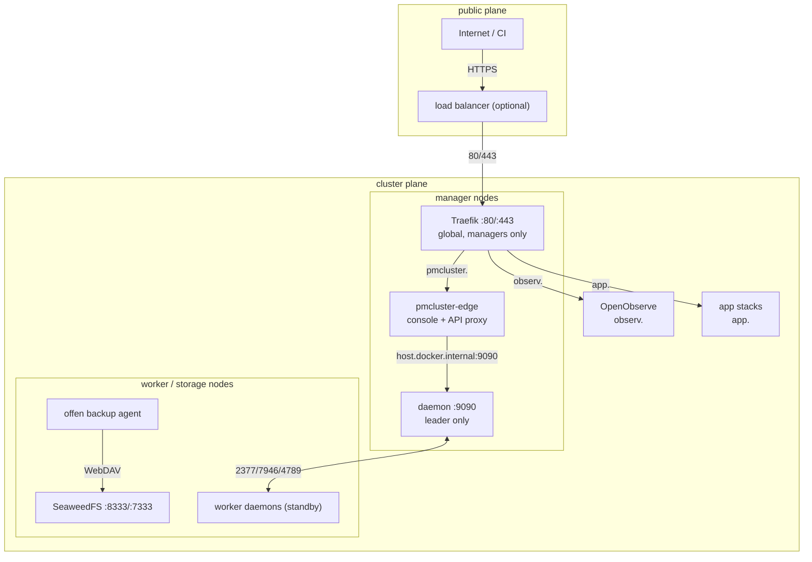
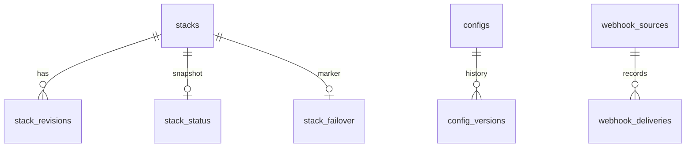
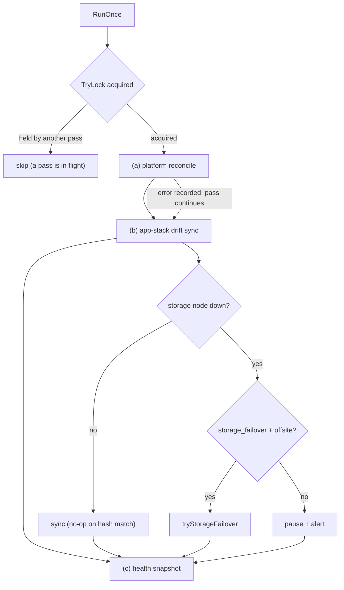
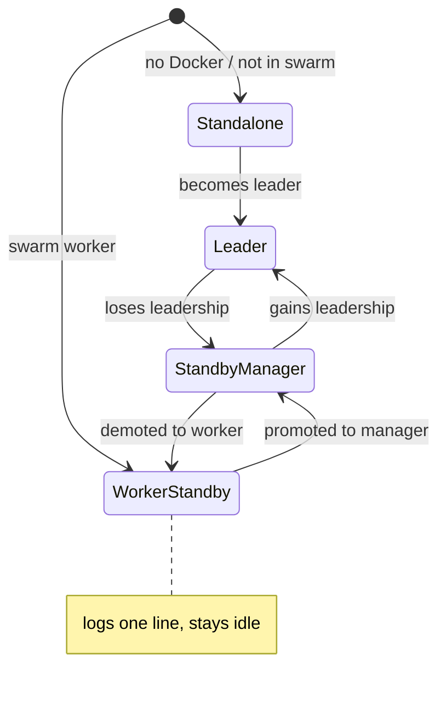
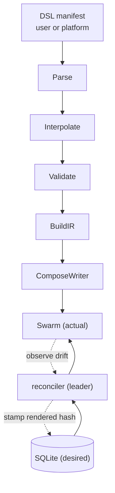
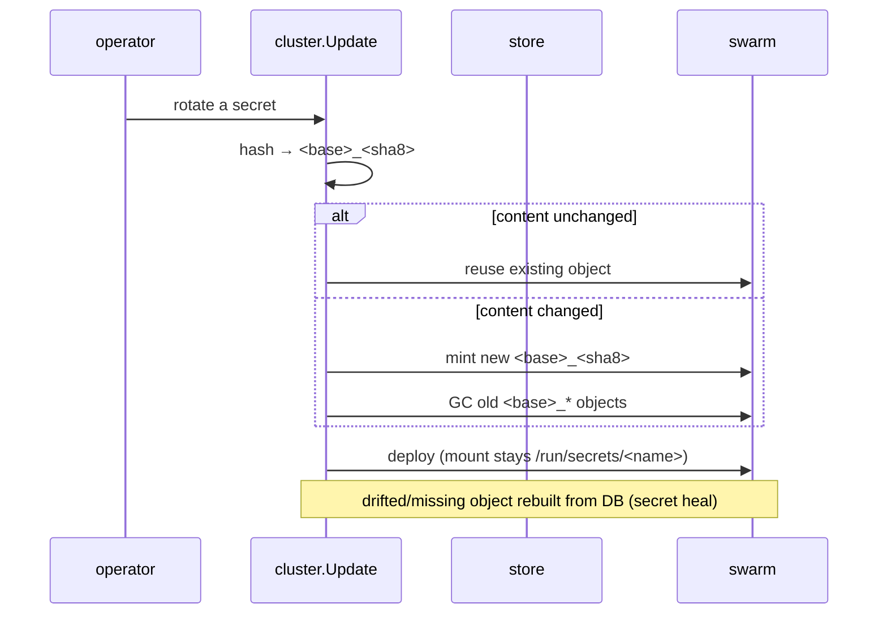
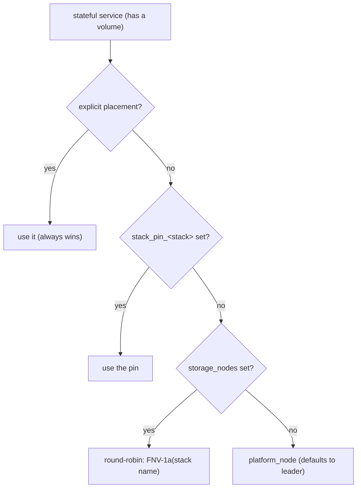
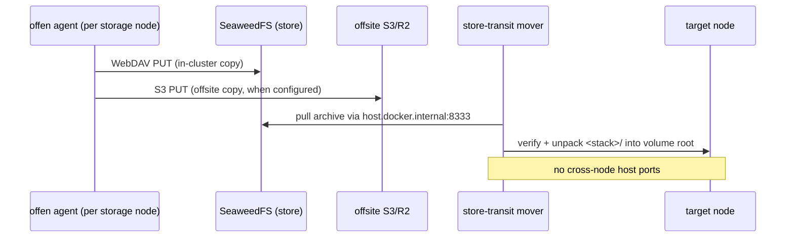
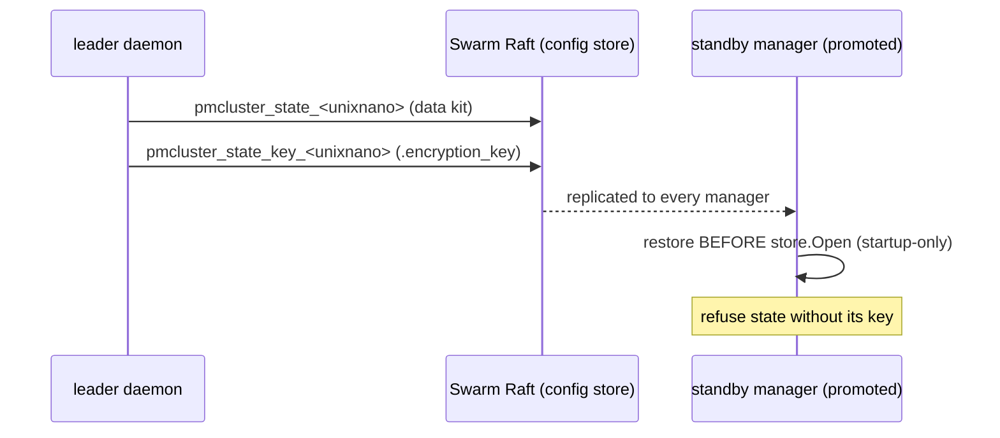
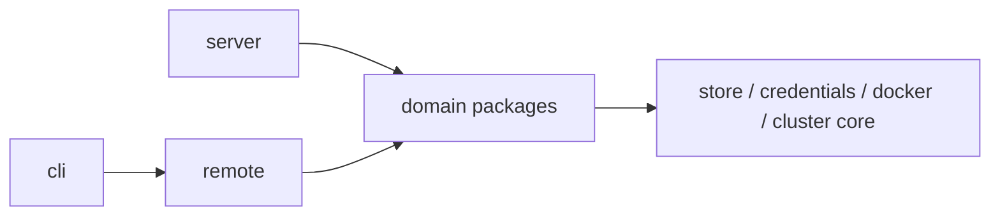

# Poor Man's Cluster (pmcluster) — Technical Whitepaper

This paper documents the platform as built — v0.2.180 (commit 3cfb86c, 2026-10-09). It describes the system as it exists, not a proposal; release-by-release history lives in CHANGELOG.md.

## 1. Abstract

pmcluster is a self-hosted PaaS control plane for cheap VPS hardware: one static Go binary that turns 1-core / 1.8 GB servers into a Docker Swarm application platform. It ships a declarative YAML DSL, a desired-state SQLite store, a leader-only reconcile loop that converges the Swarm onto it, content-addressed secrets and configs, node-pinned storage with opt-in S3 failover, double-written backups, and a console behind a Traefik auth gate. Its central question — "how do I make stateful data highly available?" — has a one-sentence answer: pin the service to a node and back it up hourly instead of replicating the block device.

Sources: README.md; docs/storage-and-databases.md; pmcluster/internal/ARCHITECTURE.md.

## 2. Problem

Hosting stacks on rented VPSes is cheap and leaves no redundancy. A single €5/month box runs a dozen small apps but dies alone; a handful of boxes gives redundancy only if the operator carries five burdens: orchestration (scheduling and restarting containers across machines), ingress (TLS for many hostnames routed to the right container), state (where a database's files live when the machine dies), secrets (keeping passwords out of git and `docker inspect`), and recovery (backups that restore onto another machine in time). Managed Kubernetes, managed databases, Longhorn, Rook/Ceph, and LINSTOR/DRBD9 all cost more in RAM, disk, and complexity than the applications they would run. A LINSTOR deployment alone is a JVM controller with embedded-etcd HA, per-node satellites, and DRBD9 kernel modules — roughly a gigabyte of RAM before any application data exists.

Sources: docs/storage-and-databases.md (Path 1 and the LINSTOR cost table); docs/network-topology.md.

## 3. Hardware envelope

The platform targets a known set of node classes:

| Node class | Role | Notes |
|---|---|---|
| "big" leader (`nxt-sw-1-m`) | Swarm leader, platform services | 2 vCPU / 3.7 GiB; the only node with headroom for JVM-class workloads |
| 1-core / 1.8 GiB managers (`nxt-sw-2-m`, `nxt-sw-4-m`) | managers, standby daemons | Traefik + OTel + standby |
| 1-core / 1.8 GiB worker (`nxt-sw-3-w`) | worker + backup store | a worker that also serves as a storage node |
| small production VPSes (`nextrum-sy-1`, `nextrum-sy-2`, `wafaa`) | production | single manager + worker + single node |

Two consequences follow, and both are invariants in the code. Heavy platform services must be pinned: on an all-manager swarm `node.role == manager` constrains nothing, so a JVM-class workload like OpenObserve could land on a 1-core node and starve it; `platform_node` defaults to the leader, and the backup store is pinned away from the platform and storage nodes. There is no spare capacity for a storage layer, which is why the HA story is pin + backup + restore rather than replication.

Sources: docs/storage-and-databases.md; pmcluster/internal/cluster/cluster_state.go; pmcluster/internal/stacks/placement.go.

## 4. Design goals

Six numbered, checkable claims; the rest of the document argues for them.

- **G1 — The database is the source of truth; the Swarm is derived.** Everything Swarm-visible (networks, secrets, configs, services, labels) rebuilds from the store; `cluster reset` rebuilds it non-destructively from SQLite.
- **G2 — One render pipeline for everything.** Platform stacks are DSL manifests (`platform: true`) on the same Parse → Interpolate → Validate → BuildIR → ComposeWriter path as user apps.
- **G3 — Content addressing over version counters.** Every Swarm config and secret is named `<base>_<sha8>`, immutable, reused when unchanged, and rebuildable from the store when missing.
- **G4 — Fail loudly, never silently.** A failed deploy looks drifted to the next pass; a restore that cannot reach the owning node fails explicitly rather than writing to the wrong disk.
- **G5 — Cheap by default, HA by option.** The default is one VPS with hourly local backups; offsite, multi-manager HA, and storage failover are opt-in.
- **G6 — The operator can reason from the console.** Status badges read the control loop's `stack_status` snapshot, never live Docker, so they cannot flicker or lie; "unknown" is a first-class state.

Sources: pmcluster/internal/manifest/; pmcluster/internal/store/store.go; pmcluster/internal/reconcile/reconcile.go.

## 5. Assumptions and non-goals

Stated before any architecture, so a recorded rejection is not re-proposed.

Rejections: no Kubernetes (a second orchestrator backend is a possible future seam, not a plan); no block-level replication (LINSTOR/DRBD9 is off the roadmap); no shared data plane deployed by the platform (NFS/GlusterFS/JuiceFS are bring-your-own); no git access from the edge (`repo_url` is provenance metadata only, never cloned); no auto-restart of unhealthy services (health reported, retries left to Swarm's restart policy); no automatic move-back after failover (a failed-over stack stays where it landed until acked); no raw-compose deploys (`deploy` accepts only a pmcluster manifest); no per-node ephemeral firewall ports for data transit.

Working assumptions: single-writer SQLite, because exactly one daemon serves at a time; reconcile runs only on the leader; Traefik runs only on managers.

Sources: docs/dsl.md; docs/storage-and-databases.md; pmcluster/internal/cli/leader.go.

## 6. System overview

One binary assumes different roles per node, runs a leader-only reconcile loop, and pins a set of platform services. On the leader it owns a desired-state store, control loop, backup pipeline, and console/API; elsewhere it stands by and repairs node-local storage. The topology:

What to look for: two planes — outside the cluster box is public, inside is node-to-node.

The invariant it encodes: the only public path to the daemon runs through Traefik and the edge; nothing else on the cluster plane is reachable.

By name: Swarm is the orchestrator; the daemon is the leader-only control plane; the edge (`pmcluster-edge`) is its only public proxy; Traefik fronts ingress; OpenObserve is observability; SeaweedFS is the backup store; the offen agents write backups; SQLite holds desired state.

Sources: docs/network-topology.md; pmcluster/internal/cluster/embeds/infra-stack.yml; pmcluster/internal/cli/serve.go.

## 7. The store and the reconcile loop

Desired state lives in local SQLite at `~/.pmcluster/data.db`, opened with `journal_mode(DELETE)`, `busy_timeout(5000)`, `foreign_keys(1)`, and `SetMaxOpenConns(1)` on the pure-Go `modernc.org/sqlite` driver. Actual state is the Swarm: services, networks, secrets, configs, node labels. The leader-only reconciler bridges them, one pass at a time behind a `TryLock`.

The store schema, as the migrations define it: sixteen tables, of which these eight carry relationships. The other eight — `users`, `managed_credentials`, `secrets`, `registries`, `rendered_configs`, `backups`, `cluster_settings`, `site_certs` — are standalone rows keyed by name, with no edges between them.

What to look for: one status row and one failover marker per stack, one version history per config.

The invariant it encodes: G1 holds structurally — all platform state is a row, and the Swarm reconstructs from it.

Each pass runs three sub-passes: (a) platform reconcile via `cluster.Update`, (b) app-stack drift sync via `stacks.Sync`, (c) a health snapshot written into `stack_status`. A failing pass records its error and does not stop the remaining passes — a broken platform pass still produces a health snapshot. Docker events (debounced 2 s) trigger the loop, plus a safety-net ticker (default 60 s; `0` disables).

What to look for: the three passes in order and the dotted failure edge.

The invariant it encodes: a failing pass is recorded and the rest still run.

Drift comes from two signals. Stored-vs-fresh: each stack stores the hash of what pmcluster last intended; a sync re-translates the stored `source_yaml` and compares, and a match means nothing to deploy. Fresh-vs-live: every service carries an `io.pmcluster.rendered_hash` label that `stackdrift.InSync` compares against the fresh render, so out-of-band service changes are re-applied although the stored hash is unchanged. The label is stamped only after a successful apply, so a failed deploy always looks drifted and is retried.

The daemon role machine decides which node may run that loop:

What to look for: three stable states; leadership gain and loss are the only manager-state edges.

The invariant it encodes: only the leader runs the control loop; a worker idles, a standby manager polls every 15 s.

When a stack's pinned storage node is down (absent, not `ready`, or not `active`), its sync is paused — deploying onto a node that cannot serve the data would recreate tasks against empty binds. With `storage_failover=true` and offsite backups, the loop moves the stack to a healthy alternate node instead, restoring the failed node's newest archive, with a 5-minute per-stack cooldown; the move leaves a `stack_failover` marker the badge reads as `failover` until acked.

Sources: pmcluster/internal/store/store.go; pmcluster/migrations; pmcluster/internal/reconcile/reconcile.go; pmcluster/internal/stackdrift/stackdrift.go; pmcluster/internal/cli/leader.go.

## 8. The render pipeline and content addressing

Every config — platform or application — becomes a Swarm object through one pipeline: Parse (strict YAML, unknown keys rejected at every level) → Interpolate (`${…}`) → Validate → BuildIR (a neutral intermediate representation) → ComposeWriter (Compose v3.9). Platform stacks are the same thing with a Go-template pre-pass (`cluster.LoadComposeFile`) that emits a DSL manifest; `platform: true` reserves the stack from the app drift loop and is refused in user manifests. The IR is the writer seam: intent in the IR, mechanism in the writer.

What to look for: one top-to-bottom pipeline and one convergence loop feeding back through the store.

The invariant it encodes: exactly one place turns a config into a Swarm object — one hash, one deploy path, one purge path.

Configs and secrets are content-addressed. `dataHash` computes the SHA-256 of the payload and the object name is `<base>_<sha8>` (the first 8 hex chars). Identical content reuses the existing object; a change mints a new name and garbage-collects the old; the in-use object is immutable, so rotation is safe by construction. Translate reads values swarm-first and rebuilds a missing object from the DB — `cluster update` runs a rebuild-on-missing repair pass, and `pmcluster secret heal` verifies and re-materialises every secret. Every user-derived string in a rendered compose doubles its literal `$` to `$$` so compose interpolation cannot truncate a value like `p@ss$word`.

What to look for: the hash decision branching on unchanged vs changed content, plus the rebuilt-from-DB note.

The invariant it encodes: objects are immutable by naming — the same bytes always name the same object, so a deploy can never half-rotate.

Sources: pmcluster/internal/manifest/; pmcluster/internal/cluster/secrets.go; pmcluster/internal/store/secrets.go.

## 9. Storage and placement

Every container volume lands under a single host root (`volume_root`, default `/var/stack/data`). Named volumes become bind `driver_opts` with `device: <root>/<app>/<name>`; host bind mounts move under the root; raw `binds:` entries (docker.sock, sockets, device paths) pass through verbatim. A per-node volume-repair loop in every daemon recreates missing bind-source directories for the stateful services the Swarm placed on that node — a manager-side repair: the leader and standby managers run it, and a worker silently no-ops (a worker cannot list services).

`PinResolver.ResolvePlacement` decides placement once, deterministically:

What to look for: the strict precedence from explicit to pin to round-robin to fallback.

The invariant it encodes: one deterministic order decides where stateful data lands, so a move is an explicit act, not a scheduler whim.

The storage-node model makes that order meaningful. `cluster up` seeds the leader's hostname into `storage_nodes`, and every `cluster update` re-adds the current leader — the leader is always a storage node. Workers qualify too: `pmcluster join --storage-node` stamps the swarm-visible `pmcluster.storage` label on the joiner, and the leader's next update adopts labeled-but-unlisted nodes. Storage follows leadership: a manager that loses leadership leaves `storage_nodes` and loses its label; the promoted leader is added. Every deployed service carries an `io.pmcluster.node` label naming its data home, visible in the console and `service ps`.

Sources: pmcluster/internal/stacks/placement.go; pmcluster/internal/cluster/cluster_state.go; docs/storage-and-databases.md; pmcluster/internal/cli/serve.go (volume-repair loop).

## 10. Backups and restore

Backups are three components rendered from the platform `backup-stack.yml`: the agents, the in-cluster store, and the offsite double-write. The offen agents run `mode: global` constrained to storage-labeled nodes when `storage_nodes` is set, or a single replica on the platform node otherwise; the schedule is hourly by default with 15-day retention, and a second agent archives the control plane daily at 03:00 with 30-day retention. The in-cluster store is one SeaweedFS process serving the S3 API on :8333 (on the routing mesh, reachable at loopback on every node) and WebDAV on :7333 (cluster-internal), pinned to a non-storage, non-platform node so the durable copy lives in a different failure domain than the data. When `backup_s3_*` is configured, each agent writes every archive twice — WebDAV to the store, native S3 to offsite.

What to look for: the double-write at the top and the store-as-transit at the bottom.

The invariant it encodes: data moves between nodes only through the object store over the routing mesh, never over host ports, so recovery needs no firewall rules.

The store-transit mover pulls the archive from the store via `host.docker.internal:8333`, verifies it contains the stack's data, and unpacks the `<stack>/` subtree into the target's volume root from a one-shot Swarm service pinned to the target. `stack move` triggers a fresh backup then transits; storage failover pulls the failed node's newest archive and never a fresh backup; `backup restore` is routed to the owning node and fails loudly when routing is impossible. A restore
replaces: entries under the restored scope that the snapshot did not hold are removed after extraction, so a
volume returns as the snapshot captured it rather than as a merge of two points in time — the scope comes
from the snapshot, so an app deployed after the backup is untouched. `cluster down --purge` writes a restorable `purge-backup-<ts>.tar.gz` first, and `cluster reset --restore <archive>` extracts it before rebuilding the Swarm side from the DB.

Sources: pmcluster/internal/cluster/embeds/backup-stack.yml; pmcluster/internal/stacks/move_store.go; pmcluster/internal/backups/.

## 11. Control-plane survivability

The control plane survives the loss of its own leader through a Raft-replicated survivor kit. The leader runs `controlplane.Kit.Loop` — a 5-minute tick plus an immediate snapshot on promotion — publishing two Docker config families: `pmcluster_state_<unixnano>` (a tar.gz of `data.db`, `config.yaml`, and the `config/` tree) and `pmcluster_state_key_<unixnano>` (the `.encryption_key` bytes alone). A restore refuses a state config whose key config is missing, so key and ciphertext never share one blob. Swarm's Raft store replicates both to every manager; snapshots prune to the newest two and fail loudly above Docker's 500 KiB config ceiling.

What to look for: the two configs published separately, and the restore positioned before the store opens.

The invariant it encodes: key and ciphertext live in separate configs and restore happens only at startup — a promoted leader publishes, never restores under its own live connection.

Restore is startup-only because `Restore` truncates `data.db`, which under a live SQLite connection would split-brain the daemon (stale page-cache rows against a clobbered file). It runs only when the local DB is missing or older than the snapshot, and repairs a missing encryption key even when the DB is current. On a worker or a leaderless swarm it is a no-op that retries later — `IsSwarmUnavailable` recognises the stable "not a manager" / "does not have a leader" messages, so a daemon starting during a quorum outage stands by instead of crash-looping.

Sources: pmcluster/internal/controlplane/state.go; pmcluster/internal/cli/serve.go; pmcluster/internal/cli/leader.go.

## 12. Networking, ingress, and auth

Traffic splits into two planes: the public plane (browsers → Traefik 80/443, DNS) and the cluster plane (Raft 2377, gossip 7946, VXLAN 4789, daemon 9090, store 8333), which must never be internet-reachable. Traefik is a `mode: global` service constrained to `node.role == manager` — its Swarm provider lists services through the local Docker socket, which only a manager can read, so a worker replica would have no routers. The ingress routing mesh still fronts the gateway from every node: 80/443 are published in `ingress` mode, so any node receiving traffic forwards it to a Traefik task on a manager. TLS is operator-supplied (`cluster up --cert/--key`, replicated as versioned Swarm secrets) or Let's Encrypt ACME; per-host certs render into the Traefik dynamic config.

The edge (`pmcluster-edge`) is the only public path to the daemon. It applies per-IP rate limits (200 req/s, burst 400 on `/api/*`, 40 req/s on `/webhook/*`), a 1 MB body cap rejected with 413, and an automatic IP ban list. The daemon listens on `0.0.0.0:9090` so the edge reaches it over `host.docker.internal`; `harden-host.sh` denies 9090 to the WAN. The auth gate has two modes: Traefik `basicAuth` (htpasswd) or GitHub SSO via oauth2-proxy (org/repo-restricted), gating `/web/*` and `observ.<domain>`. When the gate owns authentication (`edge_login_disabled=true`), the console runs as a synthetic admin in stateless mode — no `pmui-data` volume, in-memory store, no user rows — so there is one user database, not two.

Sources: docs/network-topology.md; pmcluster/internal/cluster/embeds/infra-stack.yml; pmcluster/internal/edgeproxy/; docs/console.md.

## 13. Security model

One table states the trust boundary:

| Layer | Mechanism | Where it lives |
|---|---|---|
| API tokens | Argon2id (`t=2, m=64MiB`) hashes; `pmc_<token_id>_<secret>` format with indexed lookup and fast-reject of non-`pmc_` bearers | `internal/store/users.go`, `internal/auth/` |
| Credential storage | AES-256-GCM ciphertext in SQLite, key at `~/.pmcluster/.encryption_key` (0600), mirrored to content-addressed Swarm secrets | `internal/credentials/`, `internal/cluster/secrets.go` |
| Webhooks | HMAC-SHA256 over `timestamp‖body`, ±5 min window, constant-time compare, uniform 401, mandatory `repo_url`+`file` provenance | `internal/webhooks/` |
| Daemon RBAC | Bearer tiers admin > operator > viewer (migration 0025); `pmcluster user create` mints admin-tier tokens, console API keys are operator-tier; rendered configs require operator, secret-ish settings masked for non-admins | `internal/auth/`, `migrations/0025_users_role.sql` |
| Console RBAC | Session roles admin > operator > viewer; synthetic-admin behind the gate | `internal/ui/` |
| CSRF | Origin/Referer host must match on state-changing POSTs; cookieless POSTs (curl/CLI) allowed | `internal/ui/` |
| RealIP | XFF/X-Real-IP honoured only from trusted CIDRs | `internal/server/` |
| Sessions | Random persisted 32-byte secret (never the built-in default), `Secure` on HTTPS, bcrypt >72 bytes rejected | `internal/ui/` |
| Edge | Rate limits, bans, 413 body caps | `internal/edgeproxy/` |
| Platform flag | `platform: true` refused in user manifests, so a customer stack cannot masquerade as platform | `internal/stacks/deploy.go` |
| OpenObserve surface | `openobserve-auto-auth` Traefik middleware injects the root-admin credential (Basic header + 30-day `auth_tokens` cookie) only after the `admin-auth`/`sso-auth` gate, and is omitted when the credential is unset — never exposed unpaired | `internal/cluster/embeds/traefik-dynamic.yml` |

Sources: pmcluster/internal/store/users.go; pmcluster/internal/auth/; pmcluster/internal/webhooks/; pmcluster/internal/edgeproxy/; pmcluster/internal/server/.

## 14. Design rationale

Grouped by concern: the problem that forced the choice, the option taken, the alternatives rejected, the cost accepted.

**Orchestrator.** A Kubernetes port changes the operational contract on cheap VPSes without adding value, so we kept Swarm, isolating the Docker client behind `internal/runtime`. We rejected k3s: better scheduling primitives, a different contract. The cost is Swarm's limits — no dependency graph, no CSI.

**One render pipeline.** Platform stacks were hand-written compose with a separate injection path, so a config became a Swarm object twice; we route them through the user pipeline via `platform: true`. We rejected two paths synced by hand. The cost is DSL primitives for platform stacks — `mode: global`, node constraints, raw binds, a verbatim `volumes:` map.

**Content addressing.** `_v1/_v2/…` names churned on unchanged values and collided when two writers raced a counter, so we name configs and secrets `<base>_<sha8>` and keep the in-use object immutable. We rejected version counters as the state that desynchronises between DB and Swarm. The cost is a rebuild-on-missing repair pass.

**The store.** The control plane needs state that survives the leader's disk, so we chose local SQLite plus a Raft-replicated survivor kit of Docker configs. We rejected a shared Postgres — one node's volume dies with the node — and Docker's own config store. The cost is single-writer SQLite, fine when one daemon serves.

**SQLite journal mode.** The store originally ran in WAL mode. A second process — the CLI, or any tool — that opened and closed the database deleted the `-wal`/`-shm` sidecars while the long-running daemon still held them open, leaving the daemon writing to an orphaned inode: a split-brain database, 401s for previously-valid tokens, and rows invisible to fresh readers. The store now runs with `journal_mode=DELETE`. We rejected keeping WAL and forbidding multi-process access because the CLI is a second process by design, so the rule would be unenforceable; we rejected moving off SQLite for the reasons above. The cost is lower write throughput, irrelevant with `SetMaxOpenConns(1)`.

**In-cluster backup store.** A second copy inside the swarm keeps node loss off the external S3 endpoint, so we adopted SeaweedFS after trying MinIO (image pull problems, unwanted UI), Garage (bootstrap ceremony), and kopia (an awkward credential path). The cost is one more pinned service, configured once.

**Backup replication.** The offen agent double-writes natively — WebDAV to the store, S3 to offsite — so no replicator runs. We rejected the rclone sidecar that used to sync the copies: an extra service and an extra failure mode. The cost is `AWS_S3_BUCKET_LOOKUP: path` on offen's S3 backend, and the store owns bucket creation.

**Storage-node model.** Stateful stacks need a home that follows leadership, so the leader is always a storage node, workers optionally so, and storage follows leadership. We rejected a fixed anchor, which could strand the backup agent and console on an ex-leader. The cost is that expanding `storage_nodes` re-pins only future deploys.

**HA story.** We chose Path 1 — pin + backup + restore — over block replication. We rejected LINSTOR/DRBD9 for the footprint in section 2 and because a replicated device still needs the backup pipeline. The cost is a minutes-scale restore window on node loss.

**Storage failover.** Failover is opt-in, S3-only, and never moves back by itself. We rejected alert-only — a dead storage node means a dead stack — and automatic move-back, a live workload racing a restore with no authoritative disk. The cost is an ack-required marker the operator must clear.

**Restore routing.** Restores go to the owning node through the store-transit mover. We rejected ephemeral per-move host ports, which needed firewall openings hardened hosts do not have. The cost is a one-shot mover service and three fixes for its `docker service create` quirks.

**Ingress and auth.** Traefik is pinned to managers, the gate owns auth, and the console runs synthetic-admin behind it. We rejected global Traefik everywhere — routerless worker replicas caused a production 404 outage — and console-native login as default: two user databases. The cost is no per-user console RBAC in gated mode.

**Control-plane correctness.** Restore is startup-only, the rendered hash is stamped only after a successful apply, and `depends_on` is enforced by the control plane. We rejected restoring under a live connection (split-brain) and shell wait-wrappers for ordering (they break baked-entrypoint and distroless images). The cost is that `rendered_yaml` is an audit artifact, never executed.

**Release workflow.** One tag per verified build: the tag is cut after verification completes and production rolls that single tag. We rejected tagging ahead of verification, which forces either a second tag or a rollout of a known-bad build. The cost is fewer tags per week; a green tag rolls once.

Sources: pmcluster/internal/store/store.go; pmcluster/internal/cluster/secrets.go; pmcluster/internal/stacks/placement.go; pmcluster/internal/reconcile/reconcile.go; pmcluster/internal/controlplane/state.go; pmcluster/internal/runtime/.

## 15. Known limitations and open questions

What is still broken or open, and what the design knowingly does not do.

A stack row written before `App.volumes` became a map still fails to decode, permanently, and nothing migrates or prunes it. The loop tolerates the row — each distinct sync error is logged once and the stack is marked `error` — so the open question is policy rather than mechanics: compat-decode the legacy shape, or prune orphaned local rows. Neither path is written.

ACME behind a round-robin load balancer cannot be solved from inside the cluster: HTTP-01 requires the requesting host to answer the challenge, the balancer may hand that request to any node, and each Traefik instance holds only its own ACME state. The documented escapes are an operator-supplied certificate, a DNS-01 certificate issued outside the cluster, or a terminating balancer. The open question is whether an externally-issued DNS-01 certificate replaces an operator-supplied certificate, or operator-supplied certificates are the permanent policy.

Accepted costs, visible and unresolved:

- The `$`-escaping rule exists twice: `manifest.escapeCompose` and `cluster.escapeComposeDollar` are the same `strings.ReplaceAll(s, "$", "$$")` in two render paths, and nothing stops the next escaping fix from landing in one and not the other.
- The dependency rule in `internal/ARCHITECTURE.md` — domain packages depend on the core, never on transport — is enforced by review alone: `.golangci.yml` enables no import-boundary linter, so an upward edge can grow silently. The `stacks` → `cluster` edge an earlier draft recorded here was removed at v0.2.180 when `runtime.StackDeployer` was extracted, and `ARCHITECTURE.md` lists `cluster` core as a permitted dependency in any case.
- Secret masking is one policy (`settings.IsSecretKey`) applied at three call sites — the settings HTTP handler, the CLI printer, the console form — and the policy matches on the key *name*: a secret-ish setting whose key contains none of `secret`, `password`, `key`, `token`, `credential` reaches a non-admin unmasked.
- Expanding `storage_nodes` re-pins round-robin stacks on their next sync without moving their data, so a stack can land on a node whose bind source does not exist and stay rejected until `pmcluster stack move` runs. There is no rebalance-with-migration, so a data move is always an explicit act.

Sources: pmcluster/internal/ARCHITECTURE.md; pmcluster/internal/stacks/placement.go.

## 16. Package map and reading order

One entry point per question:

| I want to know… | Read |
|---|---|
| What the daemon does on startup / promotion | `internal/cli/serve.go`, `internal/cli/leader.go` |
| How desired state becomes Swarm state | `internal/manifest/` → `internal/stacks/deploy.go` |
| How drift is detected and repaired | `internal/reconcile/`, `internal/stackdrift/` |
| Where data lives and who decides | `internal/stacks/placement.go`, `internal/cluster/` |
| How it is backed up and moved | `internal/backups/`, `internal/stacks/move_store.go` |
| How the control plane survives its own leader | `internal/controlplane/state.go` |
| How secrets and configs are addressed | `internal/cluster/secrets.go`, `internal/refs/` |
| What the operator sees | `internal/ui/`, `internal/server/`, `internal/edgeproxy/` |
| How the store is read and migrated | `internal/store/`, `migrations/` |
| How the CLI picks local vs remote backends | `internal/cli/backend.go`, `internal/remote/` |

The dependency rule that governs all of it, from `internal/ARCHITECTURE.md`:

What to look for: both composition roots pointing at the domains, and the domains pointing only down at the core.

The invariant it encodes: domain packages depend only on the core, never on transport — only the CLI and the server choose between local and remote.

Sources: pmcluster/internal/ARCHITECTURE.md; pmcluster/README.md (layout).

## 17. Sources

The document is grounded in the code under `pmcluster/` and the migrations `pmcluster/migrations`. A file is named only after opening it and checking its claim; where a claim could not be verified it is dropped or, in section 15, stated as unresolved.
